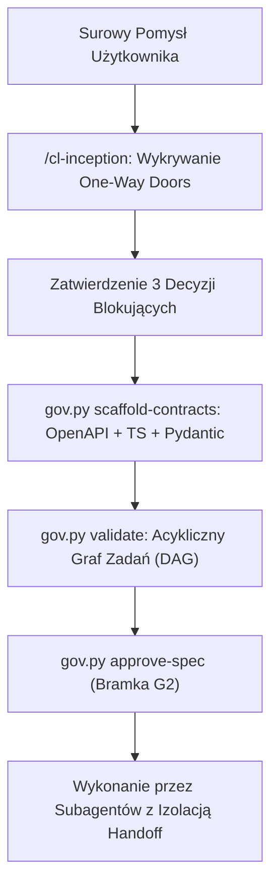
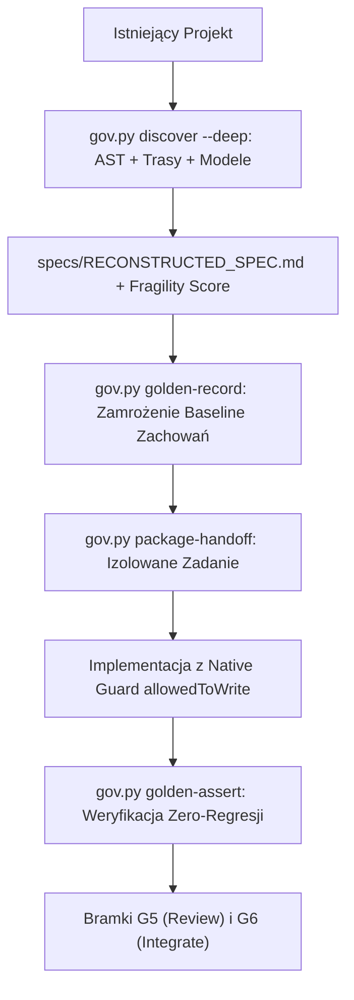
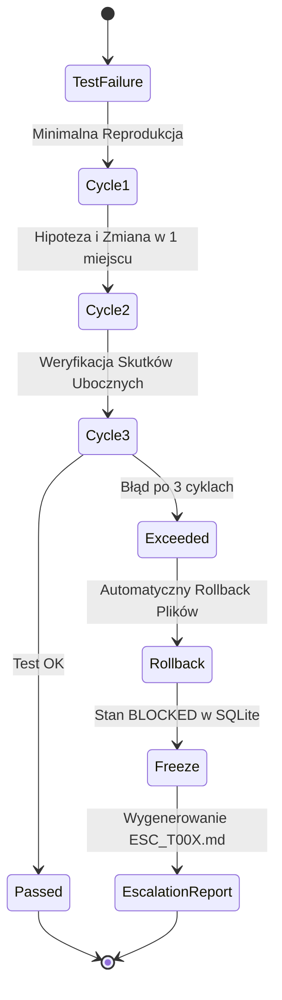

> [!NOTE]
> Dokumentacja historyczna wersji v4.0. Aktualna specyfikacja systemu operacyjnego agentów znajduje się w [docs/ARCHITECTURE_V5.md](ARCHITECTURE_V5.md) (Antigravity Ultra v5.1).

# DOKUMENTACJA ARCHITEKTONICZNA: ANTIGRAVITY ULTRA (v4.0)
### Pełna specyfikacja Agentic OS dla środowiska Antigravity 2.0

## 1. Wprowadzenie i Cele Architektoniczne
Antigravity Ultra v4.0 to autonomiczny system operacyjny dla zespołów agentów AI, rozwiązujący krytyczne ograniczenia modeli LLM:
* **Halucynacje i dryf kontekstu:** eliminowane przez podejście Contract-First i schematy OpenAPI/TypeScript.
* **Modyfikacje poza zakresem:** blokowane na poziomie jądra hooków przez `native_guard.py` i pakiety Handoff.
* **Niekończące się pętle błędów:** eliminowane przez 3-cyklową maszynę stanów samoleczenia z automatycznym rollbackiem i eskalacją do człowieka.
* **Regresje w kodzie produkcyjnym:** eliminowane przez deterministyczny harness Golden Master z dynamicznym maskowaniem.

---

## 2. Diagram Przepływu Greenfield (S0)


---

## 3. Diagram Przepływu Brownfield (S1)


---

## 4. Specyfikacja 3-Cyklowej Pętli Samoleczenia


---

## 5. Standard Pakietyzacji Handoffu (JSON Schema)
Pakiet `.governance/handoffs/<task_id>.json` posiada ścisłą strukturę:
```json
{
  "taskId": "T001",
  "taskName": "Nazwa zadania",
  "specDigest": "sha256...",
  "targetFiles": {
    "readOnly": ["contracts/types.ts", ".specify/specs/02_ARCHITECTURE.md"],
    "allowedToWrite": ["src/modules/auth.ts"]
  },
  "acceptanceCriteria": [
    {
      "id": "AC-01",
      "assertion": "Warunek akceptacyjny",
      "testCommand": "python -m unittest tests/test_auth.py"
    }
  ],
  "mockContext": {
    "mockServerUrl": "http://127.0.0.1:4010",
    "governanceProfile": "standard"
  },
  "executionBudget": {
    "maxAttemptCycles": 3,
    "timeoutSeconds": 1800
  }
}
```

Wszystkie operacje zapisu są weryfikowane przez hook `native_guard.py` w czasie rzeczywistym przed dotknięciem dysku.
