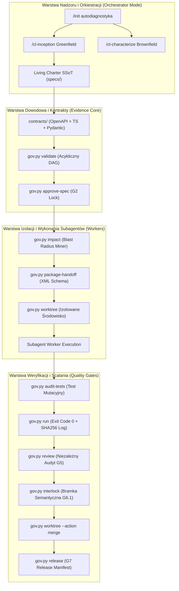

# ARCHITEKTURA TECHNICZNA: ANTIGRAVITY ULTRA v5.1 (OMNI-AGENTIC OS)
### Specyfikacja Systemowa dla Pełnego Cyklu Wdrożenia Projektu przez Wielu Subagentów

---

## 1. Architektura Wykonawcza (System Layers)

---

## 2. Model Predykcji Wpływu i Blast Radius

Moduł `gov.py impact` bada powiązania symboli przed modyfikacją kodu:
* Wykrywa importy bezpośrednie i przechodnie (do 3 poziomów głębokości).
* Automatycznie dołącza listę `affectedChecks` do wymagań handoffu.
* Zapobiega łamaniu cudzego kodu przez wczesne ostrzeganie subagenta w sekcji `<blast_radius_warnings>`.

---

## 3. Izolacja Przestrzeni Roboczych (Worktrees)

Zamiast pracy wielu agentów w jednym katalogu:
1. Każde zadanie uruchamia się w `.worktrees/{task_id}` z własną gałęzią Git.
2. Gdy Git jest nieaktywny, silnik tworzy bezpieczny katalog cieniowy `.shadow_worktrees/{task_id}`.
3. Synchronizacja z głównym projektem następuje dopiero po pomyślnym zaliczeniu bramek G4, G5 i G6.1.

---

## 4. Wykrywacz Testów Pozornych (Mock-Breaker)

Mechanizm `gov.py audit-tests`:
1. Sprawdza obecność asercji w plikach testowych.
2. Wstrzykuje mutację syntaktyczną (`raise RuntimeError`) do implementacji.
3. Jeśli test przejdzie mimo uszkodzonego kodu — zostaje bezwzględnie zablokowany jako tautologia.

---

## 5. Matryca Śledzenia Wymagań (Traceability Matrix)

W pliku `specs/05_TRACEABILITY_MATRIX.md` framework utrzymuje pełną historię:
* Identyfikator Wymagania (`REQ-T001`)
* Tytuł i Zadanie
* Stan Bramki (`DONE`, `ACTIVE`, `BLOCKED`)
* Przypisane skrypty testowe
* Exit Code i skrót SHA256 logu
* Status i autor recenzji (`APPROVED by agent:qa`)

---

## 6. Silnik Egzekwowania Reguł Projektowych DREE (v5.1)

Silnik DREE (.governance/standards.json oraz gov.py check-standards / scaffold-unit) odpowiada za wymuszenie dyscypliny architektonicznej modeli LLM:

1. **Standard 7 Niezmienników Kompletnej Funkcji:**
   - Contract-First (dataclass(frozen=True) / interfejs TS)
   - Boundary Validation (jawna asercja wejścia)
   - Domain Exceptions (zakaz surowego xcept:)
   - Clean Code (funkcje <= 40 linii, SRP)
   - Zero Console (zakaz print() / console.log)
   - Dual Test Suite (Happy-Path + Negative Edge-Case z asercją rzucania wyjątku)
   - SSoT Sync (wpis w specs/03_DATA_DICTIONARY.md i __all__)
2. **Egzekucja Maszynowa w Bramce G4:**
   - Analizator AST sprawdza kod przed dopuszczeniem do przeglądu recenzenta.
   - Naruszenie standardu powoduje natychmiastowe odrzucenie z kodem wyjścia 2 (STANDARDS_VIOLATION).
