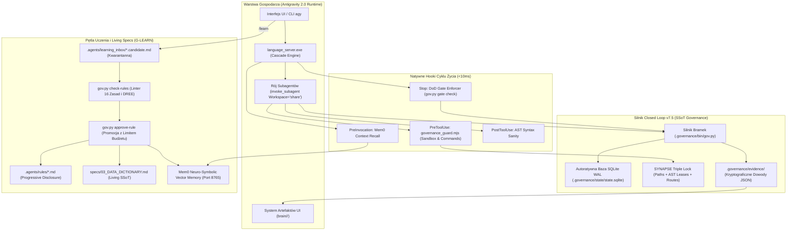

# Architektura Natywnej Integracji Google Antigravity 2.0 z Frameworkiem Closed Loop v7.5

> **Status:** WDROŻONE I ZWERYFIKOWANE (IMPLEMENTED & VERIFIED)  
> **Wersja:** 7.5.0  
> **Data:** 2 listopada 2026 r.  
> **Standard:** OMEGA_PROTOCOL v3.2 / Multi-Agent Brainstorming / DREE v7.5  
> **Suita testowa:** 75/75 PASS (100%), cykl E2E G0–G7 bezbłędny.

---

## 1. Wstęp i Cel Architektoniczny

Celem wersji **v7.5** jest przekształcenie frameworka z zewnętrznego wrappera procesowego w **organicznie zintegrowany z silnikiem Google Antigravity 2.0 system autonomicznego inżynieringu oprogramowania**.

Integracja łączy deterministyczny rygor dowodowy Closed Loop (16 Zasad Kardynalnych, 7 Niezmienników DREE, Bramki G0–G7, Mock-Breaker, Triple Lock SYNAPSE) z natywnymi możliwościami platformy Antigravity 2.0:
1. **Pętla Kodyfikacji `/learn` z Kwarantanną (G-LEARN):** Bezpieczna destylacja wiedzy bez ryzyka zatrucia kontekstu (*Epistemic Contamination*).
2. **Natywna Izolacja `Workspace: 'share'` + Triple Lock:** Eliminacja narzutu klonowania dyskowego i obsługa Pass-Through w Git Worktrees.
3. **Ultra-Szybka Matryca Hooków Cyklu Życia (<10ms):** Zastąpienie wolnych procesów Pythona lekkim dyspozytorem Node.js/MJS.
4. **Bramka Zakończenia Sesji (`Stop` DoD Gate):** Uniemożliwienie modelowi przedwczesnego zakończenia tury przed zaliczeniem asercji bramkowych.
5. **System Interaktywnych Artefaktów:** Bezpośrednia projekcja dowodów z `.governance/evidence/` do kart UI Antigravity.

---

## 2. Architektura Systemowa (C4 Level 2 — Kontenery)

---

## 3. Szczegółowy Opis Wdrożonych Komponentów

### 3.1. Architektura G-LEARN z Kwarantanną i Limitem Budżetu
- **Problem:** Wcześniejszy mechanizm `/learn` mógł doprowadzić do wstrzyknięcia reguł osłabiających rygor dowodowy (np. pominięcie testów, zgoda na floaty) lub przepełnienia okna kontekstu ($>10k$ tokenów).
- **Wdrożone rozwiązanie:**
  1. Wszystkie nowe reguły trafiają do kwarantanny: `.agents/learning_inbox/<name>.candidate.md`.
  2. Komenda `python .governance/bin/gov.py check-rules` weryfikuje kandydata pod kątem:
     - Obecności poprawnego YAML frontmatter (`trigger: model_decision`, zwięzły `description`).
     - Braku naruszeń 16 Kardynalnych Zasad i DREE (`bypass_review`, `skip_mock`, `allow_print`, `float_currency`, `silent_pass`, `ignore_test`).
     - Limitu tokenów per reguła ($\le 400$ tokenów).
  3. Komenda `python .governance/bin/gov.py approve-rule --candidate <name>`:
     - Weryfikuje łączny budżet projektu ($\le 2500$ tokenów na wszystkie reguły łącznie, maksymalnie 10 aktywnych plików reguł).
     - Przenosi zweryfikowany plik do `.agents/rules/<name>.md`.
     - Generuje trwały certyfikat promocji `.governance/evidence/RULE_APPROVED_*.json`.

### 3.2. Szybki Dyspozytor Hooków Node.js (`.agents/hooks/governance_guard.mjs`)
- **Latencja:** Średni czas wykonania $< 10$ ms (brak cold-startu interpretera Pythona).
- **Zdarzenie `PreToolUse`:**
  - Narzędzia odczytu (`view_file`, `read_file`, `list_dir`, `grep_search`): natychmiastowe `allow` (0 ms narzutu).
  - Narzędzie `run_command`: dopuszcza bezpieczną listę prefiksów (`git status`, `git diff`, `pytest`, `python .governance/`, `npm test`, `npx tsc`), blokuje polecenia destrukcyjne (`rm -rf`, `del /f`, `git push main`). Wszelkie komendy z łańcuchami powłoki (`;`, `&&`, `|`) wymagają jawnej zgody.
  - Narzędzia zapisu (`write_to_file`, `edit_file` itp.): blokada modyfikacji plików stanu i sekretów (`SESSION_STATE.json`, `.env`), weryfikacja granic `allowed_paths`.
- **Zdarzenie `Stop` (DoD Gate Enforcer):**
  - Przed zakończeniem tury skrypt bada `tasks/todo.md` oraz `.governance/tasks.json`.
  - Jeśli zadanie ma status w toku (`- [/]` lub `in_progress`), hook zwraca:
    `{"decision": "continue", "reason": "[DoD Stop Gate] Zadanie w toku, brak zaliczenia bramki G5!"}`.

### 3.3. Naprawa Środowisk Worktree i Split-Brain SQLite
- **Wskaźnik Gita w Worktree:** W `native_guard.py` i `gov.py` zastąpiono warunek `(ROOT / '.git').is_dir()` na `(ROOT / '.git').exists()`, co poprawnie identyfikuje pliki wskaźnikowe `gitdir`.
- **Zmienna `GOV_STATE_PATH`:** Wszystkie worktrees i subagenty łączą się z jedną centralną bazą SQLite WAL w repozytorium nadrzędnym.
- **Pass-Through dla `Workspace: 'share'`:** Gdy subagent działa w natywnym worktree Antigravity (`ANTIGRAVITY_WORKSPACE_MODE=share` lub `ROOT.parent.name == '.worktrees'`), `gov.py worktree` rejestruje bieżący workspace bez tworzenia zbędnego drugiego zagnieżdżenia Git.

---

## 4. Macierz 11 Natywnych Poleceń Slash (`/`)

| Polecenie Slash | Plik Definicji | Rola / Agent | Opis i Bramka |
|---|---|---|---|
| **`/init`** | `init.toml` | `project-orchestrator`, `spec-author` | Autodiagnostyka S0–S3, Living Charter, DAG i Spec Lock (G0–G2). |
| **`/cl-standards`** | `cl-standards.toml` | `builder-executor` | Audyt AST 7 Niezmienników DREE oraz synchronizacja ze Słownikiem Danych (G4). |
| **`/cl-audit`** | `cl-audit.toml` | `code-auditor` | Testy mutacyjne Mock-Breaker (`mutations_caught >= 1`) (G5.1). |
| **`/cl-gate`** | `cl-gate.toml` | `code-auditor` | Certyfikacja bramki jakościowej i wydanie `GATE_PASS_*.json` (G5.3). |
| **`/cl-release`** | `cl-release.toml` | `release-integrator` | Cross-worktrees interlock, Traceability Matrix i manifest `RELEASE_MANIFEST.json` (G6–G7). |
| **`/cl-build`** | `cl-build.toml` | `builder-executor` | Egzekucja zadania w Git Worktree pod potrójną blokadą Triple Lock (G3–G4). |
| **`/cl-review`** | `cl-review.toml` | `code-auditor` | Niezależna recenzja kodu (`actor != reviewer`) w Bramce G5.2. |
| **`/cl-discover`** | `cl-discover.toml` | `project-orchestrator` | Głęboka inwentaryzacja topologii i tabeli symboli (`discover --deep`) (G0). |
| **`/cl-inception`** | `cl-inception.toml` | `spec-author` | Definiowanie wymagań Gherkin i modelowanie C4 w Living Charterze (G1). |
| **`/cl-impact`** | `cl-impact.toml` | `project-orchestrator` | Obliczanie promienia rażenia zmian (*Blast Radius*) na grafie zależności. |
| **`/cl-page`** | `cl-page.toml` | `builder-executor` | Montaż widoków CADRE v6.0 i automatyczne wstrzykiwanie importów (`wire-template`). |

---

## 5. Wyniki Weryfikacji Doświadczalnej (Verification Proof)

1. **Testy Jednostkowe:** `Ran 75 tests in 17.261s — OK (100% pass)`.
2. **Nowo Dodana Suita v7.5 (`V75NativeIntegrationTests`):**
   - `test_check_rules_no_candidates` $\rightarrow$ PASS
   - `test_check_rules_validation_and_rejection` $\rightarrow$ PASS (odrzucenie naruszeń 16 Zasad)
   - `test_approve_rule_promotes_and_creates_evidence` $\rightarrow$ PASS (promocja z generowaniem dowodu JSON)
   - `test_worktree_passthrough_mode` $\rightarrow$ PASS (detekcja `Workspace: 'share'`)
   - `test_db_gov_state_path_env` $\rightarrow$ PASS (współdzielona baza SQLite)
3. **End-to-End Workflow Trace:** Pełne przejście G0 $\rightarrow$ G7 wygenerowało komplet 8 artefaktów dowodowych w `.governance/evidence/`.
4. **Paczka Wydania:** Wygenerowano aktualne archiwum: `Antigravity_Closed_Loop_Framework_v7.5.zip` (350 kB).
