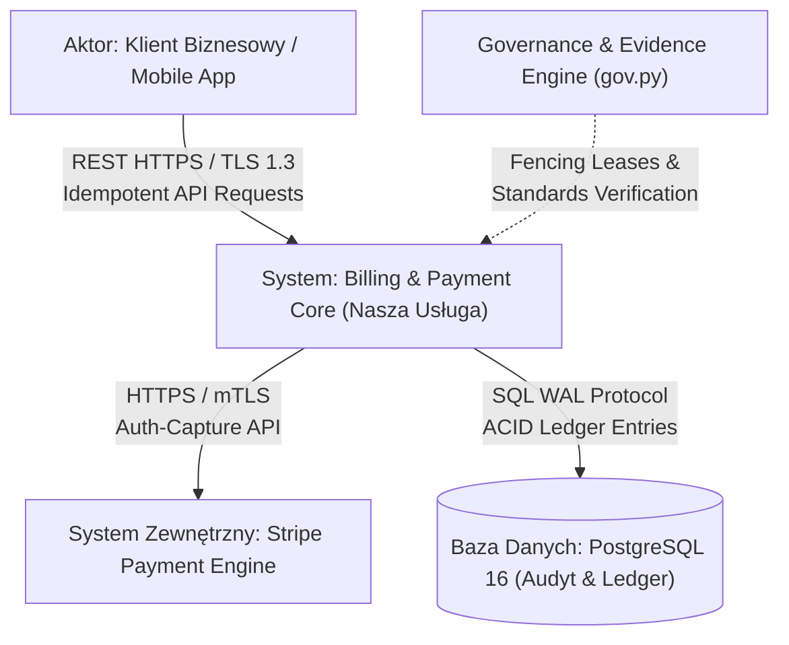
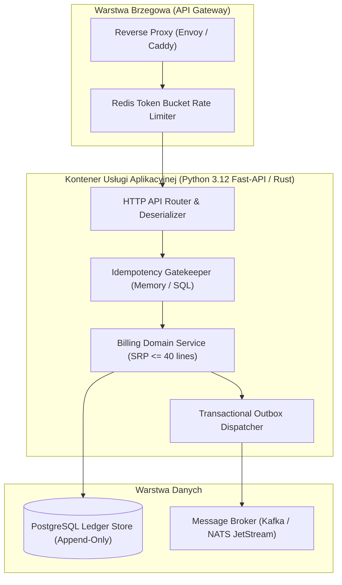
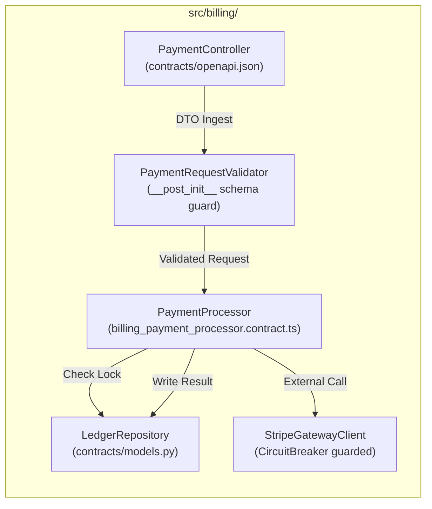
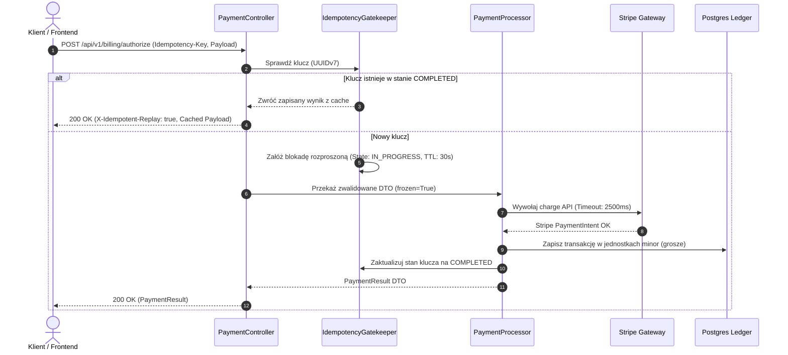
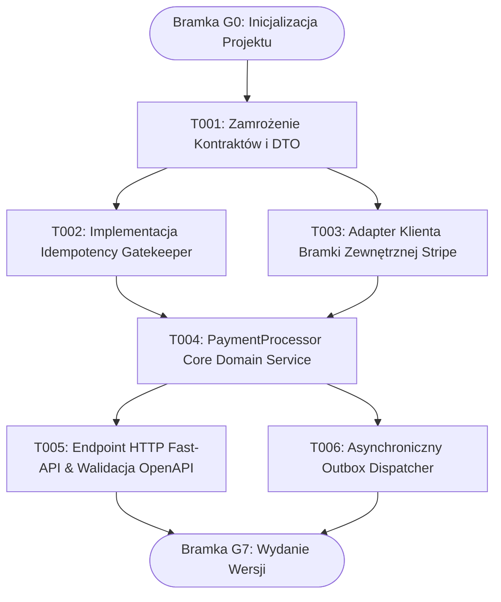
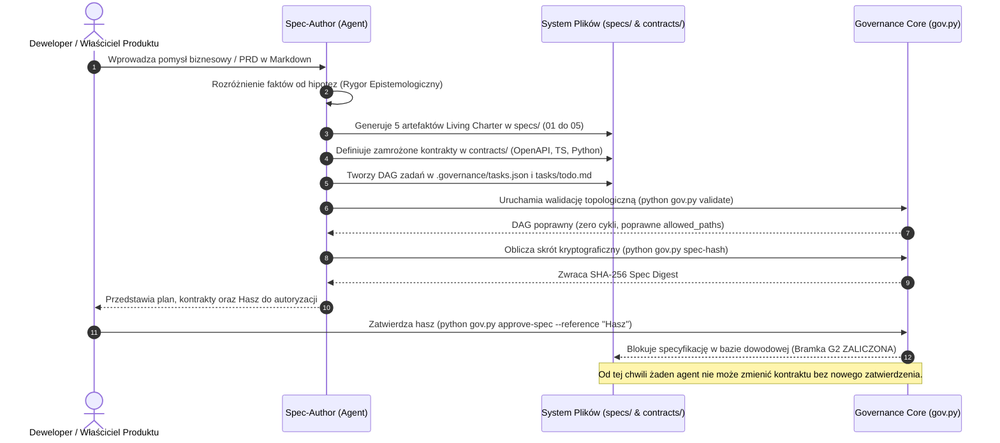

# STANDARD LIVING CHARTER & DAG SPECIFICATION (DREE v8.0)
### Architektura Wdrożeniowa Deterministycznego Wytwarzania Oprogramowania dla Systemów Multi-Agentowych

---

## 1. Wstęp i Rygor Epistemologiczny (DREE v8.0)

W architekturze autonomicznych agentów programistycznych (Multi-Agent OS), naturalny język konwersacyjny cechuje się wysoką entropią i niedookreśleniem semantycznym. Standard **DREE v8.0** (*Deterministic Requirements & Evidence Engine*) eliminuje halucynacje i dryf architektoniczny poprzez zasadę **Zero Ambiguity** opartą na trzech fundamentach:

1. **Rygor Epistemologiczny:** Bezwzględne oddzielenie **faktów** (udowodnione zachowania w kodzie, zweryfikowane testy, istniejące pliki) od **hipotez i założeń** (wymagania biznesowe, oczekiwany throughput, plany refaktoryzacji).
2. **Kryptograficzna Niezmienność Specyfikacji (Bramka G2):** Żaden agent kodujący nie ma prawa rozpocząć implementacji przed zamrożeniem specyfikacji. Zatwierdzenie nie jest luźną zgodą tekstową, lecz podpisaniem kryptograficznego skrótu SHA-256 (`spec-hash`), wyliczanego deterministycznie z zawartości plików `specs/*`, `contracts/*`, `.governance/config.json` oraz `.governance/tasks.json`.
3. **Formalizm RFC 2119 i Gherkin SSoT:** Wymagania muszą być skodyfikowane z użyciem słów kluczowych RFC 2119 (*MUST*, *MUST NOT*, *REQUIRED*, *SHALL*, *SHOULD*, *MAY*) oraz scenariuszy akceptacji *Given / When / Then*, mapowanych 1:1 na testy jednostkowe i mutacyjne.

---

## 2. Standard 5 Kluczowych Artefaktów Living Charter (`specs/`)

Katalog `specs/` stanowi **Single Source of Truth (SSoT)** całego systemu. Każdy artefakt pełni dedykowaną, ortogonalną rolę i nie może powielać niespójnych informacji.

```
specs/
├── 01_PRODUCT_REQUIREMENTS.md   # Wymagania PRD, RFC 2119, Scenariusze Gherkin
├── 02_SYSTEM_ARCHITECTURE.md    # C4 Container/Component, Przepływy Danych, Granice
├── 03_DATA_DICTIONARY.md        # Encje, Typy, Ograniczenia Integralności, Reguła 50
├── 04_DEPENDENCY_AND_IMPACT.md  # Acykliczny DAG Zadań, Blast Radius, Worktrees
└── 05_TRACEABILITY_MATRIX.md    # Macierz Śledzenia Req <-> Contract <-> Task <-> Evidence
```

---

### 2.1. `specs/01_PRODUCT_REQUIREMENTS.md`

#### Rola i Zawartość:
Dokument wymagań produktowych (PRD). Zawiera precyzyjną definicję problemu, cele biznesowe, wykluczenia (Non-Goals), macierz wymagań funkcjonalnych skategoryzowanych według MoSCoW oraz sformalizowane scenariusze akceptacyjne Gherkin.

#### Szablon Kanoniczny:
```markdown
# PRODUCT REQUIREMENTS DOCUMENT (PRD) — LIVING CHARTER
> Standard: DREE v8.0 | Status: FROZEN (G2 Lock) | Target Spec-Hash: PENDING_CALCULATION

## 1. Cel Biznesowy i Stan Epistemologiczny
### 1.1. Problem Statement
[Jednoznaczny opis problemu użytkownika lub luki systemowej z podziałem na stan zastany i docelowy]

### 1.2. Klasyfikacja Epistemologiczna
* **Udowodnione Fakty (Repozytorium / Środowisko):**
  - F1: Baza danych operuje na dialekcie PostgreSQL 16 z rozszerzeniem `pgcrypto`.
  - F2: Istniejący moduł `auth_service.py` wystawia tokeny JWT RS256 z czasem życia 900s.
* **Założenia i Hipotezy Projektowe:**
  - A1: Szczytowe obciążenie transakcyjne nie przekroczy 1 500 req/s w oknie 60 sekund.
  - A2: Czas odpowiedzi bramki płatniczej Stripe nie przekroczy 2 500 ms (wymagany timeout i circuit breaker).

### 1.3. Granice Zakresu (Scope Boundaries)
* **W Zakresie (In-Scope):**
  - Implementacja dwuetapowej autoryzacji płatności (Auth-Capture).
  - Deterministyczna obsługa idempotencji na poziomie nagłówka `Idempotency-Key`.
* **Poza Zakresem (Explicit Non-Goals):**
  - Obsługa płatności kryptowalutami w bieżącym wydaniu.
  - Własny moduł rozliczeń podatkowych VAT-OSS (delegowany do zewnętrznego API).

---

## 2. Słownik RFC 2119 i Zasady Rygoru
Wszystkie wymagania w sekcji 3 podlegają wykładni RFC 2119:
* **MUST / SHALL / REQUIRED:** Wymóg bezwzględny. Naruszenie blokuje bramkę jakościową G4/G5.
* **MUST NOT / SHALL NOT:** Bezwzględny zakaz architektoniczny lub implementacyjny.
* **SHOULD / RECOMMENDED:** Oczekiwane zachowanie; odstępstwo wymaga formalnego ADR (`gov.py approve-decision`).
* **MAY / OPTIONAL:** Cecha opcjonalna, dozwolona bez wpływu na integralność systemu.

---

## 3. Macierz Wymagań Funkcjonalnych (Functional Matrix)

| Req ID | Epik | Moduł Docelowy | Priorytet (MoSCoW) | Krótki Opis | Kontrakt API / DTO |
|---|---|---|---|---|---|
| `REQ-PAY-001` | `EPIC-01` | `src/billing/payment_gateway.py` | MUST | Autoryzacja i blokada środków z kluczem idempotencji | `contracts/billing.contract.ts#IPaymentGateway` |
| `REQ-PAY-002` | `EPIC-01` | `src/billing/settlement.py` | MUST | Księgowanie rozliczenia w jednostkach minor (grosze/centy) | `contracts/models.py#SettlementBatch` |
| `REQ-NOT-001` | `EPIC-02` | `src/notifications/dispatcher.py` | SHOULD | Asynchroniczna wysyłka potwierdzenia transakcji (Webhook/Email) | `contracts/events.contract.ts#PaymentCompletedEvent` |

---

## 4. Scenariusze Akceptacyjne (Gherkin Acceptance Criteria)

### Scenariusz REQ-PAY-001.1: Pomyślna autoryzacja transakcji z unikalnym kluczem idempotencji
```gherkin
Feature: Autoryzacja Płatności
  As a Klient systemu e-commerce
  I want Bezpiecznie autoryzować obciążenie karty
  So that Zamówienie zostało zrealizowane bez ryzyka podwójnego obciążenia

  Scenario: Autoryzacja transakcji z nowym kluczem idempotencji
    Given Klient posiada aktywny portfel z saldem co najmniej 15000 groszy
    And Nagłówek "Idempotency-Key" zawiera unikalny identyfikator UUIDv7 "018e3a2b-8a4c-7c01-9a4f-0123456789ab"
    When Zostaje wysłane żądanie POST "/api/v1/billing/authorize" z kwotą 12900 groszy i walutą "PLN"
    Then Odpowiedź serwera MUST zwrócić status HTTP 200 OK
    And Ciało odpowiedzi MUST zawierać status transakcji "AUTHORIZED"
    And Rekord w bazie danych MUST zawierać zablokowaną kwotę 12900 groszy bez użycia wartości zmiennoprzecinkowych
    And W rejestrze audytowym MUST pojawić się dokładnie jedno zdarzenie "PaymentAuthorized"
```

### Scenariusz REQ-PAY-001.2: Wykrycie zduplikowanego żądania (Idempotency Replay)
```gherkin
  Scenario: Próba ponownego wysłania żądania z identycznym kluczem idempotencji
    Given Transakcja z kluczem "018e3a2b-8a4c-7c01-9a4f-0123456789ab" została pomyślnie przetworzona
    When Zostaje przesłane identyczne żądanie POST "/api/v1/billing/authorize" z tym samym kluczem
    Then Odpowiedź serwera MUST zwrócić identyczny payload autoryzacji z kodem HTTP 200 OK
    And Flaga nagłówka "X-Idempotent-Replay" MUST mieć wartość "true"
    And Żadne środki finansowe NIE MOGĄ zostać ponownie zablokowane ani pobrane
```

### Scenariusz REQ-PAY-001.3: Odrzucenie niepoprawnej waluty lub kwoty ułamkowej (Edge-Case)
```gherkin
  Scenario: Przesłanie kwoty z ułamkiem dziesiętnym lub nieobsługiwaną walutą
    Given Użytkownik przesyła payload z polem "amount_minor": 129.50 lub walutą "XYZ"
    When Walidator wejściowy modułu PaymentGateway weryfikuje payload w konstruktorze DTO
    Then Wykonanie MUST zostać przerwane przed logiką biznesową
    And System MUST rzucić wyjątek domenowy "InvalidCurrencyAmountError"
    And Odpowiedź serwera MUST zwrócić kod błędu HTTP 422 Unprocessable Entity
```

---

## 5. Wymagania Pozafunkcjonalne (NFR Matrix)
* **NFR-SEC-01:** Dane kart płatniczych (PAN, CVV) NIGDY nie mogą dotykać infrastruktury aplikacji (wyłącznie tokenizacja po stronie certyfikowanego SDK dostawcy).
* **NFR-PERF-01:** P99 czasu obsługi żądania autoryzacji poniżej 450 ms przy obciążeniu syntetycznym 200 RPS.
* **NFR-OBS-01:** Każdy log wykonawczy MUST zawierać ustrukturyzowany kontekst JSON z polami: `trace_id`, `task_id`, `idempotency_key`, `timestamp_epoch_ms`. Zakaz stosowania surowych `print()` i `console.log()`.
```

---

### 2.2. `specs/02_SYSTEM_ARCHITECTURE.md`

#### Rola i Zawartość:
Formalny opis architektury z użyciem modelu C4 (Context, Container, Component), diagramów sekwencji oraz precyzyjnych granic modułów i serwisów. Wyklucza jakiekolwiek dwuznaczności odnośnie przepływu danych i odpowiedzialności komponentów.

#### Szablon Kanoniczny:
```markdown
# SYSTEM ARCHITECTURE & C4 CONTAINER MODEL (DREE v8.0)
> Status: SSoT Architecture Definition | Engine: Antigravity Ultra v8.0

## 1. Architektura Systemu — Model C4

### 1.1. Poziom 1: Kontekst Systemu (System Context)


### 1.2. Poziom 2: Kontenery Aplikacji (Container Diagram)


### 1.3. Poziom 3: Komponenty Modułu Płatności (Component Diagram)


---

## 2. Diagram Przepływu Danych i Idempotencji (Sequence Flow)



---

## 3. Granice Modułów i Reguły Odseparowania (DDD Bounded Contexts)
1. **Zero Współdzielonego Stanu Zmiennego:** Moduły komunikują się wyłącznie poprzez zamrożone DTO i interfejsy zadeklarowane w `contracts/`.
2. **Zakaz Importów Wzajemnych (Cyclic Imports Ban):** Moduł `src/billing` NIE MOŻE importować z `src/notifications`. Komunikacja następuje asynchronicznie przez zdarzenia domenowe (`PaymentCompletedEvent`).
3. **Maksymalny Rozmiar Jednostki Roboczej:** Każda funkcja biznesowa nie może przekraczać 40 linii kodu (SRP — Single Responsibility Principle).
```

---

### 2.3. `specs/03_DATA_DICTIONARY.md`

#### Rola i Zawartość:
Ścisły słownik encji domenowych, DTO, zdarzeń i struktur danych. Wymusza **Regułę 50**: bezwzględny zakaz liczb zmiennoprzecinkowych dla walut (wymóg `integer minor`), rozróżnienie wartości pominiętych (`omitted`) od `null`, niemutowalność (`frozen=True`) oraz mapowanie na pliki definicji.

#### Szablon Kanoniczny:
```markdown
# DATA DICTIONARY & DOMAIN INVARIANTS (DREE v8.0)
> SSoT Data Schema & Invariant Registry | Enforcement: gov.py check-standards

## 1. Globalne Niezmienniki Domenowe (Reguła 50)
1. **Reguła Monetarna (Zero Float Policy):**
   - Bezwzględny zakaz typów `float`, `double` oraz `number` bez zaokrągleń stałoprzecinkowych w kalkulacjach finansowych.
   - Wszystkie kwoty walutowe MUST być przechowywane jako liczby całkowite w jednostkach podrzędnych waluty (`integer minor`, np. 1 PLN = 100 groszy -> `100`, $12.50 = `1250`).
2. **Precyzja Danych (Null vs Omitted):**
   - Pole pominięte w DTO (`undefined` / `omitted`): brak aktualizacji wartości w bazie danych.
   - Pole o wartości jawnej `null`: skasowanie / wyzerowanie wartości atrybutu w magazynie.
3. **Determinizm Identyfikatorów:**
   - Klucze główne MUST bazować na porządkowalnych czasowo identyfikatorach `UUIDv7` lub `ULID`.

---

## 2. Rejestr Encji i DTO

| Encja / Symbol | Domena | Rola Architektoniczna | Plik Kontraktu | Plik Implementacji | Niezmienniki Integralności |
|---|---|---|---|---|---|
| `PaymentAuthorizeRequest` | `billing` | Input DTO | `contracts/billing.contract.ts` | `src/billing/dto.py` | `amount_minor > 0`, waluta ISO 4217, `idempotency_key` format UUIDv7 |
| `PaymentResult` | `billing` | Output DTO | `contracts/billing.contract.ts` | `src/billing/dto.py` | `frozen=True`, `auth_code` niepuste gdy `success=True` |
| `LedgerEntry` | `billing` | Aggregate Root | `contracts/models.py` | `src/billing/ledger.py` | Append-only, brak możliwości modyfikacji rekordu po zapisie |
| `PaymentProcessorError` | `billing` | Domain Exception | `contracts/billing.contract.ts` | `src/billing/errors.py` | Dziedziczy po `Exception`, suffix `Error`, kod błędu |
| `PaymentCompletedEvent` | `events` | Domain Event | `contracts/events.contract.ts` | `src/events/payment_events.py` | Timestamp w ms, podpis kryptograficzny HMAC payloadu |

---

## 3. Szczegółowe Schematy Pól

### 3.1. Encja `PaymentAuthorizeRequest` (Input DTO)
| Pole | Typ Danych | Wymagane | Domyślnie | Ograniczenia i Format | Opis Semantyczny |
|---|---|---|---|---|---|
| `idempotency_key` | `string (UUIDv7)` | TAK | Brak | Regex: `^[0-9a-f]{8}-[0-9a-f]{4}-7[0-9a-f]{3}-[89ab][0-9a-f]{3}-[0-9a-f]{12}$` | Unikalny token operacji zabezpieczający przed duplikacją |
| `amount_minor` | `integer (int64)` | TAK | Brak | Min: `100`, Max: `100_000_000` (w jednostkach minor) | Kwota transakcji w jednostkach podrzędnych (grosze) |
| `currency` | `string` | TAK | `"PLN"` | 3-znakowy kod ISO 4217 (`PLN`, `EUR`, `USD`) | Waluta rozliczeniowa |
| `customer_id` | `string (UUIDv7)` | TAK | Brak | Poprawny format UUIDv7 | Identyfikator płatnika w relacji z tabelą `customers` |
| `metadata` | `dict[string, string]` | NIE | `{}` | Max 10 kluczy, długość wartości <= 256 znaków | Dodatkowe parametry telemetryczne |

### 3.2. Encja `PaymentResult` (Output DTO)
| Pole | Typ Danych | Wymagane | Ograniczenia | Opis Semantyczny |
|---|---|---|---|---|
| `transaction_id` | `string (UUIDv7)` | TAK | Generowany deterministycznie | Unikalny identyfikator zarejestrowanej transakcji |
| `status` | `string (Enum)` | TAK | Wartości: `AUTHORIZED`, `DECLINED`, `FAILED` | Stan autoryzacji |
| `authorized_amount_minor` | `integer (int64)` | TAK | Równe `amount_minor` z żądania | Kwota zablokowana |
| `captured_at_unix_ms` | `integer (int64)` | TAK | Timestamp w milisekundach | Czas wykonania autoryzacji |

---

## 4. Rejestr Jawnych Eksportów (`__all__` / Module Interfaces)
Każdy plik źródłowy implementujący encje domenowe MUST posiadać jawną deklarację symboli eksportowanych:
```python
# src/billing/__init__.py
__all__ = [
    "PaymentAuthorizeRequest",
    "PaymentResult",
    "PaymentProcessorError",
    "PaymentProcessor",
]
```
```

---

### 2.4. `specs/04_DEPENDENCY_AND_IMPACT.md`

#### Rola i Zawartość:
Acykliczny graf zależności zadań (DAG) oraz macierz promienia rażenia (*Blast Radius*). Dokumentuje, które pliki każdy subagent ma prawo modyfikować (`allowed_paths`), jakie checks dowodowe są wymagane oraz jak zadania są izolowane w środowiskach Git Worktree.

#### Szablon Kanoniczny:
```markdown
# TASK DEPENDENCY DAG & BLAST RADIUS MATRIX (DREE v8.0)
> SSoT Execution Plan | Engine: Antigravity Ultra v8.0 Impact Miner

## 1. Topologiczny Graf Zadań (Task DAG)
Graf musi pozostać ściśle acykliczny. Krawędzie definiują wymagane ukończenie zadania nadrzędnego (Gate G6 Merged) przed rozpoczęciem zadania podrzędnego.



---

## 2. Macierz Promienia Rażenia (Blast Radius Matrix)

| Task ID | Ścieżki Zapisu (`allowed_paths`) | Ścieżki Tylko do Odczytu | Zależności upstream (`depends_on`) | Poziom Ryzyka | Wymagane Checks Dowodowe |
|---|---|---|---|---|---|
| `T001` | `contracts/` | `specs/` | `[]` | `high` | `contracts-lint`, `type-check` |
| `T002` | `src/billing/idempotency.py`, `tests/test_idempotency.py` | `contracts/` | `["T001"]` | `medium` | `unit`, `mock-audit` |
| `T003` | `src/billing/stripe_client.py`, `tests/test_stripe_client.py` | `contracts/` | `["T001"]` | `medium` | `unit`, `circuit-breaker-test` |
| `T004` | `src/billing/payment_processor.py`, `tests/test_payment_processor.py` | `contracts/`, `src/billing/idempotency.py`, `src/billing/stripe_client.py` | `["T002", "T003"]` | `critical` | `unit`, `dual-test`, `standards-check` |
| `T005` | `src/billing/routes.py`, `tests/test_billing_api.py` | `contracts/openapi.json`, `src/billing/` | `["T004"]` | `high` | `integration-e2e`, `openapi-validate` |
| `T006` | `src/events/outbox.py`, `tests/test_outbox.py` | `contracts/`, `src/billing/ledger.py` | `["T004"]` | `medium` | `unit`, `concurrency-test` |

---

## 3. Strategia Izolacji Środowisk Roboczych (Worktrees)
Każde zadanie atomowe wykonuje się w wydzielonym katalogu roboczym generowanym przez `gov.py worktree --task {task_id}`:
* **Ścieżka robocza:** `.worktrees/{task_id}` (lub katalog cieniowy `.shadow_worktrees/{task_id}`).
* **Ochrona Fencing:** Hook `native_guard.py` blokuje wszelkie próby zapisu poza zadeklarowanymi `allowed_paths`. Naruszenie natychmiast unieważnia token wykonawczy zadania.
* **Integracja:** Scalenie do głównego drzewa następuje wyłącznie po zaliczeniu bramek G4 (Asercje testowe) oraz G5 (Niezależny audyt kodu).
```

---

### 2.5. `specs/05_TRACEABILITY_MATRIX.md`

#### Rola i Zawartość:
Dwukierunkowa macierz śledzenia wymagań łącząca wymagania biznesowe, sekcje architektury, kontrakty, zadania robocze, przypadki testowe oraz hasze dowodów wykonawczych w bazie dowodowej SQLite.

#### Szablon Kanoniczny:
```markdown
# END-TO-END TRACEABILITY MATRIX (SSoT)
> Dynamic Evidence Registry | Auto-Synchronized via gov.py trace-matrix

| Req ID | Sekcja PRD | Komponent Arch. (C4) | Kontrakt Interfejsu | Task ID | Zestaw Testów (File & Method) | Stan Bramki | Exit Code | Hash Dowodu (SHA-256) | Status Recenzji (G5) |
|---|---|---|---|---|---|---|---|---|---|
| `REQ-PAY-001` | § 4 Scen. 1.1 | `PaymentProcessor` | `contracts/billing.contract.ts` | `T004` | `tests/test_payment_processor.py::test_successful_authorization` | `DONE` | `0` | `8f5b3a...7c91` | APPROVED by agent:qa-verifier |
| `REQ-PAY-001` | § 4 Scen. 1.2 | `IdempotencyGatekeeper` | `contracts/models.py` | `T002` | `tests/test_idempotency.py::test_replay_returns_cached_response` | `DONE` | `0` | `4b12c8...310e` | APPROVED by agent:qa-verifier |
| `REQ-PAY-002` | § 4 Scen. 1.3 | `LedgerRepository` | `contracts/models.py` | `T004` | `tests/test_payment_processor.py::test_negative_fractional_amount_rejected` | `DONE` | `0` | `2e09aa...88f4` | APPROVED by agent:qa-verifier |
| `REQ-NOT-001` | § 3 Wiersz 3 | `OutboxDispatcher` | `contracts/events.contract.ts` | `T006` | `tests/test_outbox.py::test_event_dispatched_to_broker` | `PENDING` | `N/A` | `N/A` | UNASSIGNED |

---

## Reguły Niezmienności Macierzy:
1. **Zero Wymagań Sierocych (No Orphan Requirements):** Każde wymaganie `REQ-*` z pliku `01_PRODUCT_REQUIREMENTS.md` musi mieć przypisany co najmniej jeden `Task ID` oraz jednoznaczny zestaw asercji testowych.
2. **Zero Niekontraktowych Zadań:** Każde zadanie implementujące logikę domenową musi odwoływać się do zamrożonego kontraktu w kolumnie `Kontrakt Interfejsu`.
```

---

## 3. Struktura Zamrożonych Kontraktów (`contracts/`)

Zasada **Interface-First Contract Freezing** wymaga, aby przed napisaniem choćby jednej linii kodu implementacyjnego, interfejsy i modele danych zostały sformalizowane i zamrożone w katalogu `contracts/`.

```
contracts/
├── openapi.json                       # REST API Contracts (OpenAPI 3.1.0)
├── billing_payment_processor.contract.ts # TypeScript Service & Payload Contract
├── models.py                          # Python Pydantic / Frozen Dataclasses
├── lib.rs                             # Rust Core Types & Traits (jeśli wymagane)
└── events.contract.ts                 # Asynchroniczne Zdarzenia Domenowe
```

---

### 3.1. Kontrakt OpenAPI 3.1 (`contracts/openapi.json`)
```json
{
  "openapi": "3.1.0",
  "info": {
    "title": "Billing & Payment Engine API",
    "version": "1.0.0",
    "description": "Deterministyczny interfejs płatności zgodny ze standardem DREE v8.0"
  },
  "paths": {
    "/api/v1/billing/authorize": {
      "post": {
        "summary": "Autoryzacja płatności z kluczem idempotencji",
        "operationId": "authorizePayment",
        "parameters": [
          {
            "name": "Idempotency-Key",
            "in": "header",
            "required": true,
            "schema": {
              "type": "string",
              "format": "uuid"
            },
            "description": "Klucz idempotencji w formacie UUIDv7"
          }
        ],
        "requestBody": {
          "required": true,
          "content": {
            "application/json": {
              "schema": {
                "$ref": "#/components/schemas/PaymentAuthorizeRequest"
              }
            }
          }
        },
        "responses": {
          "200": {
            "description": "Pomyślna autoryzacja lub powtórzenie idempotentne",
            "headers": {
              "X-Idempotent-Replay": {
                "schema": { "type": "boolean" },
                "description": "Flaga oznaczająca pobranie odpowiedzi z pamięci podręcznej"
              }
            },
            "content": {
              "application/json": {
                "schema": {
                  "$ref": "#/components/schemas/PaymentResult"
                }
              }
            }
          },
          "422": {
            "description": "Naruszenie reguł walidacji wejściowej lub niepoprawna kwota",
            "content": {
              "application/json": {
                "schema": {
                  "$ref": "#/components/schemas/ErrorResponse"
                }
              }
            }
          }
        }
      }
    }
  },
  "components": {
    "schemas": {
      "PaymentAuthorizeRequest": {
        "type": "object",
        "additionalProperties": false,
        "required": ["amount_minor", "currency", "customer_id"],
        "properties": {
          "amount_minor": {
            "type": "integer",
            "minimum": 100,
            "maximum": 100000000,
            "description": "Kwota w jednostkach minor (grosze). Zakaz liczb zmiennoprzecinkowych."
          },
          "currency": {
            "type": "string",
            "enum": ["PLN", "EUR", "USD"]
          },
          "customer_id": {
            "type": "string",
            "format": "uuid"
          }
        }
      },
      "PaymentResult": {
        "type": "object",
        "additionalProperties": false,
        "required": ["transaction_id", "status", "authorized_amount_minor", "captured_at_unix_ms"],
        "properties": {
          "transaction_id": { "type": "string", "format": "uuid" },
          "status": { "type": "string", "enum": ["AUTHORIZED", "DECLINED", "FAILED"] },
          "authorized_amount_minor": { "type": "integer" },
          "captured_at_unix_ms": { "type": "integer" }
        }
      },
      "ErrorResponse": {
        "type": "object",
        "additionalProperties": false,
        "required": ["error_code", "message", "timestamp"],
        "properties": {
          "error_code": { "type": "string" },
          "message": { "type": "string" },
          "timestamp": { "type": "integer" }
        }
      }
    }
  }
}
```

---

### 3.2. Kontrakt TypeScript (`contracts/billing_payment_processor.contract.ts`)
```typescript
/**
 * DREE v8.0 Interface-First Frozen Contract
 * Domain: Billing | Component: PaymentProcessor
 * Reguła 50: Zero Float, Branded Types, Discriminated Unions
 */

export type MinorUnits = number & { readonly __brand: unique symbol };
export type UUIDv7 = string & { readonly __brand: unique symbol };

export type CurrencyCode = 'PLN' | 'EUR' | 'USD';
export type PaymentStatus = 'AUTHORIZED' | 'DECLINED' | 'FAILED';

export interface PaymentAuthorizePayload {
  readonly idempotencyKey: UUIDv7;
  readonly amountMinor: MinorUnits; // Grosze, liczba całkowita
  readonly currency: CurrencyCode;
  readonly customerId: UUIDv7;
  readonly metadata?: Readonly<Record<string, string>>;
}

export interface PaymentResultSuccess {
  readonly success: true;
  readonly transactionId: UUIDv7;
  readonly status: 'AUTHORIZED';
  readonly authorizedAmountMinor: MinorUnits;
  readonly capturedAtUnixMs: number;
}

export interface PaymentResultFailure {
  readonly success: false;
  readonly errorCode: string;
  readonly errorMessage: string;
  readonly status: 'DECLINED' | 'FAILED';
  readonly attemptedAtUnixMs: number;
}

export type PaymentExecutionResult = PaymentResultSuccess | PaymentResultFailure;

export interface IPaymentProcessorService {
  executeAuthorization(payload: PaymentAuthorizePayload): Promise<PaymentExecutionResult>;
}
```

---

### 3.3. Kontrakt Python (`contracts/models.py`)
```python
"""DREE v8.0 Core Contract Models.
Enforces Rule 50: Immutability (frozen=True), Integer Minor Currency, Boundary Validation.
"""
from __future__ import annotations
from dataclasses import dataclass, field
import re
from typing import Final, Literal

UUIDV7_REGEX: Final[re.Pattern[str]] = re.compile(
    r"^[0-9a-f]{8}-[0-9a-f]{4}-7[0-9a-f]{3}-[89ab][0-9a-f]{3}-[0-9a-f]{12}$",
    re.IGNORECASE,
)

class DomainValidationError(ValueError):
    """Bazowy błąd walidacji wejściowej DTO."""
    pass

@dataclass(frozen=True, slots=True)
class PaymentAuthorizeRequest:
    idempotency_key: str
    amount_minor: int
    currency: Literal["PLN", "EUR", "USD"]
    customer_id: str
    metadata: dict[str, str] = field(default_factory=dict)

    def __post_init__(self) -> None:
        if not UUIDV7_REGEX.match(self.idempotency_key):
            raise DomainValidationError(f"Invalid UUIDv7 idempotency_key: {self.idempotency_key}")
        if not isinstance(self.amount_minor, int) or self.amount_minor <= 0:
            raise DomainValidationError(f"amount_minor must be a positive integer, got: {self.amount_minor}")
        if self.currency not in ("PLN", "EUR", "USD"):
            raise DomainValidationError(f"Unsupported currency: {self.currency}")
        if not UUIDV7_REGEX.match(self.customer_id):
            raise DomainValidationError(f"Invalid UUIDv7 customer_id: {self.customer_id}")

@dataclass(frozen=True, slots=True)
class PaymentResult:
    transaction_id: str
    status: Literal["AUTHORIZED", "DECLINED", "FAILED"]
    authorized_amount_minor: int
    captured_at_unix_ms: int

    def __post_init__(self) -> None:
        if not UUIDV7_REGEX.match(self.transaction_id):
            raise DomainValidationError(f"Invalid UUIDv7 transaction_id: {self.transaction_id}")
        if self.authorized_amount_minor < 0:
            raise DomainValidationError("authorized_amount_minor cannot be negative")

__all__ = [
    "DomainValidationError",
    "PaymentAuthorizeRequest",
    "PaymentResult",
]
```

---

### 3.4. Kontrakt Rust (`contracts/lib.rs`)
```rust
//! DREE v8.0 Rust Frozen Contract
use serde::{Deserialize, Serialize};

#[derive(Debug, Clone, PartialEq, Eq, Serialize, Deserialize)]
pub enum Currency {
    PLN,
    EUR,
    USD,
}

#[derive(Debug, Clone, PartialEq, Eq, Serialize, Deserialize)]
pub enum PaymentStatus {
    Authorized,
    Declined,
    Failed,
}

#[derive(Debug, Clone, PartialEq, Eq, Serialize, Deserialize)]
pub struct PaymentAuthorizeRequest {
    pub idempotency_key: String,
    pub amount_minor: u64, // Zero Float Policy: całkowita kwota w jednostkach minor
    pub currency: Currency,
    pub customer_id: String,
}

#[derive(Debug, Clone, PartialEq, Eq, Serialize, Deserialize)]
pub struct PaymentResult {
    pub transaction_id: String,
    pub status: PaymentStatus,
    pub authorized_amount_minor: u64,
    pub captured_at_unix_ms: u64,
}
```

---

## 4. Architektura Epików, Sprintów i Zadań DAG

Plan wdrożeniowy w standardzie Living Charter operuje w układzie dwuwarstwowym:
1. **Warstwa Maszynowa (Enforced Execution Layer):** Plik `.governance/tasks.json` odczytywany przez silnik `gov.py` i hooki `native_guard.py`.
2. **Warstwa Ludzka (Human Navigation Layer):** Plik `tasks/todo.md` lub `{project-slug}-plan.md` stanowiący dynamiczny dashboard dla dewelopera i zespołu.

---

### 4.1. Hierarchia Mapowania: Epik -> Sprint -> Zadanie Atomowe
* **Epik (`EPIC-XX`):** Duży filar domenowy odpowiadający Bounded Contextowi (np. *EPIC-01: Rdzeń Płatności i Idempotencja*).
* **Sprint (`SPRINT-XX`):** Spójna faza topologiczna DAG o minimalnym blast-radius, grupująca zadania możliwe do wykonania w jednym oknie integracyjnym.
* **Zadanie Atomowe (`TXXX` / `task-*`):** Niepodzielna jednostka pracy przypisana jednemu agentowi, ograniczona do `allowed_paths`, weryfikowana przez checklistę 7 niezmienników DREE.

---

### 4.2. Schemat `.governance/tasks.json` (Warstwa Maszynowa)
```json
{
  "version": 2,
  "epics": [
    {
      "id": "EPIC-01",
      "title": "Rdzeń Płatności i Idempotencja",
      "domain": "billing",
      "description": "Bezpieczna autoryzacja transakcji, obsługa podwójnych wywołań oraz ledger."
    }
  ],
  "sprints": [
    {
      "id": "SPRINT-01",
      "epic_id": "EPIC-01",
      "title": "Kontrakty i Infrastruktura Idempotencji",
      "target_gate": "G6.1"
    },
    {
      "id": "SPRINT-02",
      "epic_id": "EPIC-01",
      "title": "Procesor Transakcyjny i API",
      "target_gate": "G7"
    }
  ],
  "tasks": [
    {
      "id": "T001",
      "epic_id": "EPIC-01",
      "sprint_id": "SPRINT-01",
      "title": "Zamrożenie kontraktów i modeli DTO billing",
      "domain": "billing",
      "symbols": ["PaymentAuthorizeRequest", "PaymentResult"],
      "allowed_paths": [
        "contracts/billing_payment_processor.contract.ts",
        "contracts/models.py",
        "contracts/openapi.json"
      ],
      "depends_on": [],
      "checks": ["framework-selftests"],
      "acceptance": [
        "Kontrakty TypeScript, Python i OpenAPI są w 100% zsynchronizowane",
        "Reguła 50 (Zero Float, walidacja wejścia) zaimplementowana w modelach"
      ],
      "risk": "low",
      "standards_checklist": [
        "interface_contract",
        "input_validation",
        "domain_exception",
        "pure_logic_srp",
        "telemetry_logging",
        "dual_test_suite",
        "export_registration"
      ]
    },
    {
      "id": "T002",
      "epic_id": "EPIC-01",
      "sprint_id": "SPRINT-01",
      "title": "Implementacja mechanizmu blokady idempotencji",
      "domain": "billing",
      "symbols": ["IdempotencyGatekeeper", "IdempotencyRecord"],
      "allowed_paths": [
        "src/billing/idempotency.py",
        "tests/test_idempotency.py"
      ],
      "depends_on": ["T001"],
      "checks": ["unit"],
      "acceptance": [
        "IdempotencyGatekeeper zapobiega powtórnemu przetworzeniu tego samego UUIDv7",
        "Odpowiedź z cache zawiera nagłówek X-Idempotent-Replay"
      ],
      "risk": "medium",
      "standards_checklist": [
        "interface_contract",
        "input_validation",
        "domain_exception",
        "pure_logic_srp",
        "telemetry_logging",
        "dual_test_suite",
        "export_registration"
      ]
    },
    {
      "id": "T004",
      "epic_id": "EPIC-01",
      "sprint_id": "SPRINT-02",
      "title": "Implementacja serwisu PaymentProcessor",
      "domain": "billing",
      "symbols": ["PaymentProcessor", "PaymentProcessorError"],
      "routes": ["/api/v1/billing/authorize"],
      "allowed_paths": [
        "src/billing/payment_processor.py",
        "tests/test_payment_processor.py"
      ],
      "depends_on": ["T002"],
      "checks": ["unit"],
      "acceptance": [
        "Spełnia kontrakt IPaymentProcessorService",
        "Testy jednostkowe pokrywają Happy Path oraz rzucanie wyjątku dla błędnej kwoty"
      ],
      "risk": "critical",
      "standards_checklist": [
        "interface_contract",
        "input_validation",
        "domain_exception",
        "pure_logic_srp",
        "telemetry_logging",
        "dual_test_suite",
        "export_registration"
      ]
    }
  ]
}
```

---

### 4.3. Szablon Ludzkiego Planu (`tasks/todo.md`)
```markdown
# LIVING CHARTER IMPLEMENTATION PLAN (tasks/todo.md)
> Project: Billing & Payment OS | Status: IN_PROGRESS | G2 Spec Lock: ACTIVE

## 📊 Postęp Ogólny Wdrożenia
- **Ukończone zadania:** 1 / 3 (33%)
- **Aktywny Sprint:** `SPRINT-01: Kontrakty i Infrastruktura Idempotencji`
- **Spec Digest (SHA-256):** `e3b0c44298fc1c149afbf4c8996fb92427ae41e4649b934ca495991b7852b855`

---

## 🚀 EPIC-01: Rdzeń Płatności i Idempotencja

### 📦 SPRINT-01: Kontrakty i Infrastruktura Idempotencji (Faza Fundamentowa)
- [x] **T001: Zamrożenie kontraktów i modeli DTO billing**
  - **Domeny:** `billing` | **Ryzyko:** `low`
  - **Zapis:** `contracts/billing_payment_processor.contract.ts`, `contracts/models.py`, `contracts/openapi.json`
  - **Zależności:** `[]` (Zadanie startowe)
  - **Status Dowodu:** EXIT 0 (`evidence/8f5b...`) | Recenzja: APPROVED

- [ ] **T002: Implementacja mechanizmu blokady idempotencji**
  - **Domeny:** `billing` | **Ryzyko:** `medium`
  - **Zapis:** `src/billing/idempotency.py`, `tests/test_idempotency.py`
  - **Zależności:** `["T001"]`
  - **Weryfikacja:** `gov.py run T002 unit` && `gov.py check-standards --task T002`

---

### 📦 SPRINT-02: Procesor Transakcyjny i API (Faza Logiki Biznesowej)
- [ ] **T004: Implementacja serwisu PaymentProcessor**
  - **Domeny:** `billing` | **Ryzyko:** `critical`
  - **Zapis:** `src/billing/payment_processor.py`, `tests/test_payment_processor.py`
  - **Zależności:** `["T002"]`
  - **DoD:**
    - [ ] Kontrakt zaimplementowany bez naruszenia typów
    - [ ] Wszystkie metody <= 40 linii kodu
    - [ ] Zero liczb zmiennoprzecinkowych (użycie jednostek minor)
    - [ ] Test mutacyjny `gov.py audit-tests --task T004` zakończony sukcesem
```

---

## 5. Checklista 7 Niezmienników DREE i Definicja Ukończenia (DoD)

Każde zadanie atomowe przekazane podagentowi kodującemu podlega bezwzględnej weryfikacji maszynowej (`standards_checklist`). Brak spełnienia któregokolwiek punktu powoduje odrzucenie zadania na bramce jakościowej G4.

| Niezmiennik | Identyfikator | Wymóg Formalny | Metoda Maszynowej Weryfikacji |
|---|---|---|---|
| **1. Interface Contract** | `interface_contract` | Kod implementuje zamrożony interfejs z `contracts/`. Modele są niemutowalne (`frozen=True`). | Analiza AST dziedziczenia i dekoratorów (`@dataclass(frozen=True)`). |
| **2. Boundary Validation** | `input_validation` | Weryfikacja argumentów wejściowych bezpośrednio w konstruktorze lub `__post_init__`. | Parsowanie węzłów AST sprawdzające asercje lub rzucenie `ValueError`/`DomainValidationError`. |
| **3. Domain Exception** | `domain_exception` | Dedykowana klasa wyjątku dziedzicząca po `Exception` z sufiksem `Error`. Zakaz surowego `except:`. | Skanowanie definicji klas pod kątem suffixu `Error` oraz zakaz surowych bloków try/except. |
| **4. Pure Logic SRP** | `pure_logic_srp` | Maksymalnie 40 linii kodu na funkcję/metodę. Dokładnie jedna odpowiedzialność logiczna. | Zliczanie linii w ciele funkcji w drzewie AST (`node.end_lineno - node.lineno <= 40`). |
| **5. Telemetry Logging** | `telemetry_logging` | Bezwzględny zakaz `print()` oraz `console.log()`. Użycie dedykowanego loggera ze strukturą JSON. | Wykrywanie wywołań wbudowanych funkcji `print` / wyrażeń `console.log`. |
| **6. Dual Test Suite** | `dual_test_suite` | Plik testowy zawiera co najmniej 1 test pozytywny (Happy Path) oraz 1 test negatywny weryfikujący rzucenie wyjątku. | Wykrywanie `assertRaises` / `pytest.raises` w pliku testowym. |
| **7. SSoT Export Sync** | `export_registration` | Klasa/funkcja jest zarejestrowana w `__all__` oraz wpisana do słownika `specs/03_DATA_DICTIONARY.md`. | Weryfikacja spójności listy `__all__` z indeksem bazy danych SQLite. |

---

## 6. Procedura Pracy Spec-Author: Od PRD do Zablokowanej Bramki G2



---

## 7. Podsumowanie Reguł Zero Ambiguity dla Subagentów Kodujących

Przed wysłaniem zadania do dowolnego podagenta wykonawczego (`worker`), prompt zadania MUSI zawierać pakiet handoffu:
1. **Zadanie i Zakres Zapisu:** Dokładny identyfikator zadania i bezwzględna granica ścieżek `allowed_paths`.
2. **Ścieżka do Kontraktu:** Wskazanie pliku w `contracts/`, którego sygnatur podagent NIE MOŻE modyfikować.
3. **Wymóg 7 Niezmienników:** Bezwzględny obowiązek zaliczenia `gov.py check-standards --task {id}` przed zgłoszeniem do recenzji.
4. **Dowód Wykonania:** Wygenerowanie dowodu testowego kodem wyjścia 0 (`gov.py run {task} {check}`).
