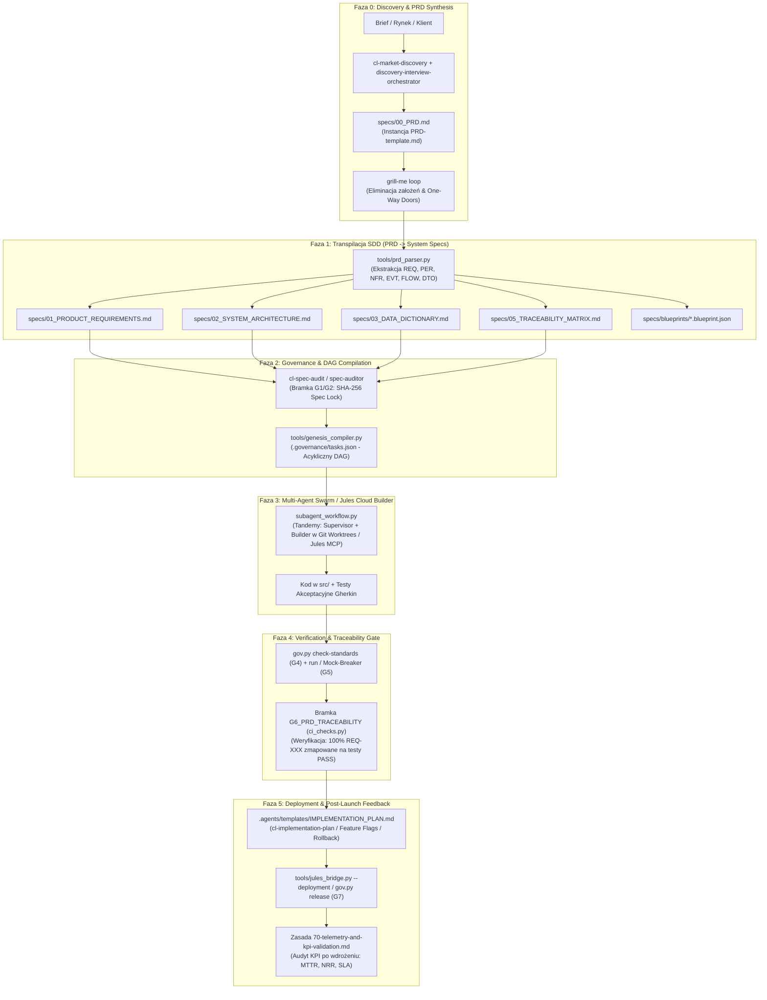

# ARCHITEKTURA INTEGRACJI PRD W WARSTWIE SPEC-DRIVEN DEVELOPMENT (SDD) — ANTIGRAVITY ULTRA v8.3

> **Status:** ARCHITECTURE_APPROVED & READY FOR JULES CLOUD BUILDER  
> **Wersja:** Antigravity Ultra v8.3 (Omni-Agentic OS)  
> **Kanon Źródłowy:** `PRD-template.md` (Single Source of Truth — SSoT)  
> **Target Repo:** `kmasternak88/antigravity-2.0-framework`  

---

## 1. WIZJA I CELE ARCHITEKTONICZNE

Głównym celem niniejszej rozbudowy jest domknięcie brakującego ogniwa w cyklu życia oprogramowania ekosystemu **Antigravity 2.0**:
**Formalne zintegrowanie biznesowego dokumentu PRD (`PRD-template.md`) z inżynieryjnym potokiem bramek dowodowych (.governance/ G1–G7).**

Dotychczasowy proces wytwórczy rozpoczynał się na poziomie specyfikacji technicznych (`specs/01_PRODUCT_REQUIREMENTS.md` do `05_TRACEABILITY_MATRIX.md`), co stwarzało ryzyko:
1. Rozjazdu między celami biznesowymi/KPI a implementacją w kodzie (Business-to-Code Drift).
2. Braku automatycznej weryfikacji, czy każde wymaganie biznesowe `REQ-XXX` zostało w 100% zaimplementowane i pokryte testem akceptacyjnym Gherkin (`Given-When-Then`).
3. Braku sformalizowanego planu wdrożenia (Rollout, Feature Flags, Rollback) po zakończeniu fazy budowy.

---

## 2. PRZEPŁYW PRACY (TARGET WORKFLOW)

---

## 3. SPECYFIKACJA 5 KLUCZOWYCH KOMPONENTÓW ROZBUDOWY

### Komponent 1: Agent Właściciela Produktu (`.agents/agents/product-manager-agent.md`)
* **Rola:** Główny analityk produktowy i biznesowy w Warstwie 1/2 ekosystemu Antigravity Ultra v8.3.
* **Zakres Odpowiedzialności:**
  * Tworzenie i utrzymanie `specs/00_PRD.md` na bazie `PRD-template.md`.
  * Egzekwowanie zasady limitu 40% pracochłonności dla wymagań `MUST HAVE` w MVP.
  * Mapowanie aktorów (`PER-XX`) na kryteria akceptacji `Given-When-Then` w wymaganiach (`REQ-XXX`).
  * Prowadzenie ustrukturyzowanych wywiadów sokratejskich w pętli `/grill-me`.
  * Nadzór nad definicją zdarzeń analitycznych (`EVT-XXX`) i metryk biznesowych (`NSM`, `NRR`, `MTTR`).

### Komponent 2: Szablon i Generator Planów Wdrożeniowych (`IMPLEMENTATION_PLAN.md` & `cl-implementation-plan`)
* **Artefakt Szablonu:** `.agents/templates/IMPLEMENTATION_PLAN.md`
  * Sekcja 1: Podsumowanie zakresu i powiązanie z `specs/00_PRD.md` oraz zadaniami `.governance/tasks.json`.
  * Sekcja 2: Strategia wydania (Canary Deployment, Blue-Green, Dark Launching).
  * Sekcja 3: Konfiguracja Feature Flags i dynamicznych przełączników funkcji.
  * Sekcja 4: Procedury Awaryjne i Rollback (automatyczne triggery progowe, skrypty migracji bazy danych DOWN, przywracanie stanu CoW).
  * Sekcja 5: Matryca Smoke Testów i weryfikacja zdrowia (Health Check endpoints).
* **Skill Operacyjny:** `.agents/skills/cl-implementation-plan/SKILL.md`
  * Integruje komendę `/cl-implementation-plan` ze stanem DAG i silnikiem deploymentu `jules_bridge.py`.

### Komponent 3: Automatyczna Bramka Zgodności PRD $\leftrightarrow$ Kod (`G6_PRD_TRACEABILITY`)
* **Lokalizacja:** `tools/ci_checks.py` oraz integracja w `.governance/bin/gov.py`.
* **Deterministyczny Algorytm Walidacji:**
  1. Parsuje `specs/00_PRD.md` (lub ścieżkę podaną w argumencie).
  2. Wyciąga listę wszystkich identyfikatorów `REQ-XXX`.
  3. Sprawdza, czy każdy `REQ-XXX` posiada wpis w `specs/05_TRACEABILITY_MATRIX.md`.
  4. Skanuje kod testów (`tests/`) w poszukiwaniu adnotacji `@test_req("REQ-XXX")` lub znacznika `REQ-XXX` w docstringach/nazwach metod testowych.
  5. Weryfikuje, czy powiązane testy zakończyły się ze statusem `PASS` w bieżącym snapshotcie dowodowym.
  6. W przypadku braku pokrycia testem lub braku zaliczenia zwraca kod błędu 1 i szczegółowy raport braków (`UNCOVERED_PRD_REQUIREMENTS`).

### Komponent 4: Pętla Zwrotna i Telemetria (`.agents/rules/70-telemetry-and-kpi-validation.md`)
* **Lokalizacja:** `.agents/rules/70-telemetry-and-kpi-validation.md`
* **Niezmiennik:** Żadne wydanie nie może zostać uznane za w 100% zrealizowane biznesowo bez skonfigurowanej telemetrii zdarzeń zdefiniowanych w Sekcji 6.2 PRD (`EVT-XXX`).
* **Procedura Po Wdrożeniu:**
  * Weryfikacja emisji zdarzeń syntetycznych w środowisku staging/canary.
  * Porównanie zmierzonych wartości z bazowymi (Baseline) i docelowymi (Target) z tabeli KPI 6.1.
  * Rejestracja odchyleń i wniosków w `.agents/learning_inbox/` w standardzie G-LEARN v8.3.

### Komponent 5: Parser Schematów PRD w Pythonie (`tools/prd_parser.py`)
* **Lokalizacja:** `tools/prd_parser.py` oraz suita testów `tests/test_prd_parser.py`.
* **Architektura Modułu:**
  * Typowane DTO (`@dataclass(frozen=True)`): `PRDMetadata`, `StrategicParameter`, `FinancialMetric`, `Persona`, `Requirement`, `UserFlow`, `ErrorScenario`, `NFRMetric`, `KPIMetric`, `TelemetryEvent`, `ParsedPRD`.
  * Klasa `PRDParser`:
    * `parse_markdown(content: str) -> ParsedPRD`: Ekstrakcja wszystkich sekcji 1–8 z pliku Markdown.
    * `validate_moscow_limit(prd: ParsedPRD) -> bool`: Egzekwuje twardą regułę inżynieryjną: `MUST HAVE <= 40%` całkowitej liczby wymagań.
    * `transpile_to_specs(prd: ParsedPRD, output_dir: Path) -> Dict[str, Path]`: Generuje `specs/01_PRODUCT_REQUIREMENTS.md`, `specs/03_DATA_DICTIONARY.md`, `specs/05_TRACEABILITY_MATRIX.md`.
    * `to_dag_task_atoms(prd: ParsedPRD) -> List[Dict[str, Any]]`: Przekształca wymagania `REQ-XXX` w atomy zadań kompatybilne z `.governance/tasks.json` i `genesis_compiler.py`.
* **Standard Jakościowy DREE:**
  * SRP $\le 40$ linii per metoda.
  * Brak surowych `print()`, brak `except: pass`.
  * Dedykowane wyjątki: `PRDParseError`, `PRDValidationError`.
  * 100% pokrycia testami jednostkowymi w `tests/test_prd_parser.py`.

---

## 4. MACIERZ ŚCIEŻEK ARTEFAKTÓW

| ID | Komponent | Ścieżka Docelowa w Repozytorium | Cel Operacyjny |
|---|---|---|---|
| 1 | Szablon PRD SSoT | `PRD-template.md` & `.agents/templates/PRD-template.md` | Kanoniczny szablon PRD dla projektów Greenfield i Brownfield |
| 2 | Agent PM/PO | `.agents/agents/product-manager-agent.md` | Subagent odpowiedzialny za PRD, KPI i MoSCoW |
| 3 | Szablon Implementation Plan | `.agents/templates/IMPLEMENTATION_PLAN.md` | Standaryzacja procedur Rollout / Rollback / Feature Flags |
| 4 | Skill Implementation Plan | `.agents/skills/cl-implementation-plan/SKILL.md` | Orkiestracja wdrożenia powiązanego z PRD i DAG |
| 5 | Reguła Telemetrii | `.agents/rules/70-telemetry-and-kpi-validation.md` | RFC pętli zwrotnej KPI i telemetrii po wdrożeniu |
| 6 | Parser PRD w Pythonie | `tools/prd_parser.py` | Parsowanie Markdown PRD, walidacja MoSCoW, transpilacja specs i DAG |
| 7 | Testy Parsowania PRD | `tests/test_prd_parser.py` | Rygorystyczna suita testowa dla parsera PRD |
| 8 | Rozszerzenie Bramki CI | `tools/ci_checks.py` | Implementacja checku `verify_prd_traceability()` (Bramka G6) |
| 9 | Dokument Architektury | `docs/PRD_SPEC_DRIVEN_DEVELOPMENT_ARCHITECTURE.md` | Pełna specyfikacja SDD dla zespołów inżynieryjnych |
