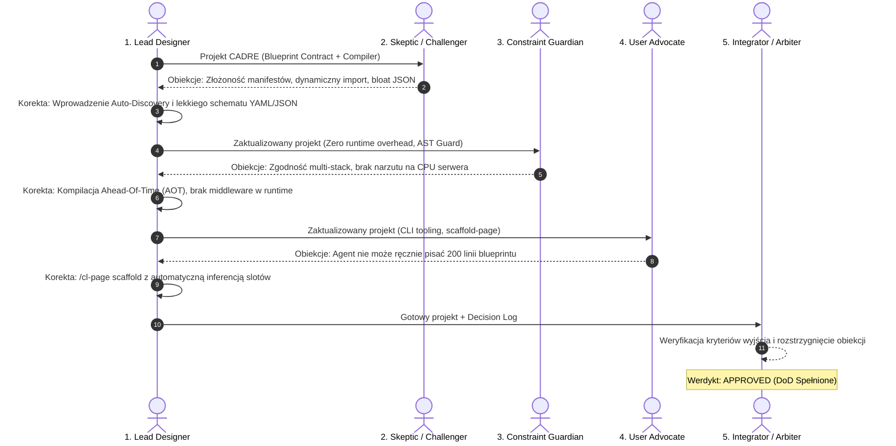
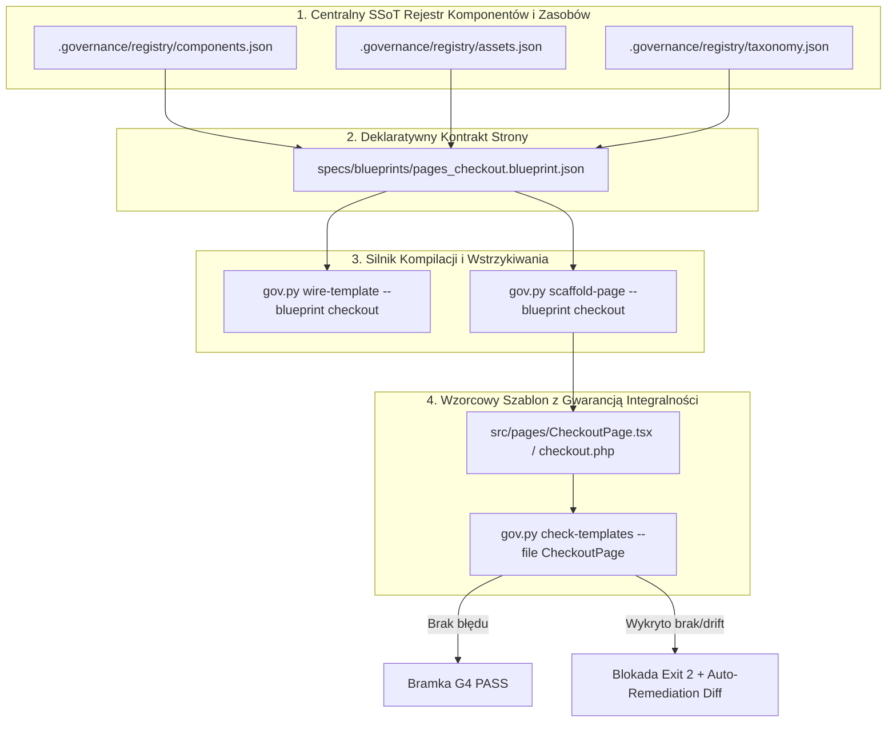

# Architektura Antigravity v6.0: System Deterministycznego Montażu Zależności i Szablonów (CADRE)

> **Protokoły bazowe:** OMEGA_PROTOCOL v3.2 (Deep/Critical Mode) & Multi-Agent Brainstorming  
> **Status:** **APPROVED (Zatwierdzony przez Arbitra)**  
> **Autor:** Lead System Architect & Multi-Agent Design Council  
> **Cel:** Całkowita eliminacja halucynacji ścieżek, brakujących importów, niespójnego nazewnictwa oraz braków w logice i zasobach podczas budowania szablonów stron przez agentów AI.  

---

## 1. Diagnoza Stanu Obecnego (Framework v5.1) i Istota Problemu

### 1.1 Co rozwiązuje Framework v5.1 DREE?
- Egzekwuje standard 7 Niezmienników Kompletności dla pojedynczych jednostek kodu (`scaffold-unit`, SRP <= 40 linii, typy, błędy domenowe, brak printów).
- Zapewnia kryptograficzne zamrażanie specyfikacji (`spec-lock`), izolację w Git Worktree i audyt mutacyjny testów Mock-Breaker (`audit-tests`).

### 1.2 Gdzie leży krytyczna luka architektoniczna? (Root Cause Analysis)
Mimo doskonałego nadzoru nad pojedynczymi funkcjami logicznymi, obecny system traktuje **szablony stron i widoki (Views / Pages / Templates)** w sposób niespójny i fragmentaryczny:
1. **Halucynacja Importów i Ścieżek (Import Drift):** Agent generujący stronę (np. w React, Vue, Blade, PHP czy Astro) zgaduje nazwy hooków, komponentów i ścieżki względne (`@/components/header` vs `../components/Header/Header.jsx`).
2. **Brakujące Zasoby i Skrypty (Asset Orphans):** Dołączenie komponentu (np. `ImageSlider` lub `StripeCheckoutForm`) wymaga powiązanych zasobów CSS, bibliotek klienckich i tokenów API. Agent często montuje sam tag HTML/JSX, zapominając o zarejestrowaniu skryptu lub stylów w nagłówku strony.
3. **Chaos Nomenklaturowy (Taxonomy Collision):** Mieszanie konwencji: `user_profile.php` używa zmiennej `$user_data`, widok podrzędny oczekuje `$userProfile`, selektor CSS ma klasę `.UserCard`, a skrypt odwołuje się do `#user-card-container`.
4. **Brak Kontraktu Całej Strony (Missing Holistic Page Contract):** Zadanie w `tasks.json` mówi „Zbuduj stronę produktu”, lecz brakuje jednoznacznego manifestu określającego: jakie sloty ma strona, jakie komponenty w nie wchodzą, jakie dane wejściowe (ViewModel) muszą być dostarczone oraz jakie są twarde zależności funkcjonalne.

---

## 2. Przebieg Procedury Multi-Agent Brainstorming

Zgodnie z procedurą `multi-agent-brainstorming`, projekt został poddany sekwencyjnemu, ustrukturyzowanemu procesowi oceny i weryfikacji przez 5 wyspecjalizowanych ról.



---

### Rola 1: Primary Designer (Główna Propozycja Architektoniczna)
**Koncepcja bazowa:** Wprowadzenie podsystemu **CADRE** (*Component Assembly & Deterministic Resolution Engine*) jako filaru Frameworka v6.0.
1. **Blueprint Contract Schema (`specs/blueprints/*.blueprint.json`):** Deklaratywny manifest strony definiujący sloty, komponenty, wymagane zbiory stylów/skryptów, ViewModel wejściowy oraz konwencje nazewnicze.
2. **Kompilator i Generator Deterministyczny (`gov.py scaffold-page` & `gov.py wire-template`):** Narzędzie, które na podstawie kontraktu blueprintu generuje w 100% poprawny kod szablonu z wstrzykniętymi importami, slotami i rejestracją zasobów — agent nie pisze importów od zera, lecz uzupełnia wyłącznie czystą logikę.
3. **Statyczny Weryfikator Szablonów (`gov.py check-templates`):** Narzędzie AST badające spójność szablonu z blueprintem przed przejściem bramki G4.

---

### Rola 2: Skeptic / Challenger (Atak na Założenia)
> *„Załóżmy, że ten system spektakularnie zawodzi na produkcji. Dlaczego?”*

1. **Obiekcja 2.1 (Mental Overhead & Agent Stagnation):** Jeśli agent przed stworzeniem prostego landing page'a będzie musiał ręcznie zdefiniować 150-linijkowy plik `blueprint.json`, zużyje cały kontekst i zacznie halucynować wewnątrz samego JSON-a.
2. **Obiekcja 2.2 (Dynamic Dependencies Blindspot):** Szablony często ładują komponenty warunkowo (np. `if (user.isVip) renderVipBadge()`). Statyczny blueprint może zablokować dynamiczne wzorce lub wymusić ładowanie wszystkich zasobów dla każdego użytkownika.
3. **Obiekcja 2.3 (Multi-Framework Fragility):** Inaczej importuje się komponenty w Next.js (`import { X } from '@/components'`), inaczej w Vue/Svelte, a inaczej w PHP/WordPress (`get_template_part()`). Czy framework nie stanie się gigantycznym, kruchym transpilatorem?

**Odpowiedź i Poprawki Lead Designera:**
- *Ad 2.1:* Wprowadzamy polecenie `gov.py scaffold-blueprint --from-wireframe`, które generuje minimalny szablon kontraktu automatycznie na podstawie słownika danych i zarejestrowanych komponentów.
- *Ad 2.2:* Blueprint obsługuje sekcje `slots[].conditions` oraz flagi `dynamic: true`, generując deterministyczne rozgałęzienia warunkowe w szablonie.
- *Ad 2.3:* CADRE wykorzystuje **Adaptery Ekosystemowe** (`framework_adapter: "react" | "vue" | "php" | "astro"`). Każdy adapter posiada własny deterministyczny format importu (`import_syntax`).

---

### Rola 3: Constraint Guardian (Strażnik Wydajności i Niezmienników)
> *„Weryfikacja ograniczeń niefunkcjonalnych: wydajność, bezpieczeństwo, brak narzutu w runtime.”*

1. **Wymóg 3.1 (Zero Runtime Overhead):** Walidacja zależności MUSI odbywać się wyłącznie w fazie kompilacji / CI (Ahead-Of-Time). Żaden silnik walidacji nie może spowalniać generowania HTML na serwerze produkcyjnym.
2. **Wymóg 3.2 (Deterministyczne Hashowanie Zasobów):** Wszystkie zewnętrzne i wewnętrzne skrypty muszą posiadać wyliczony hash integralności (SRI) lub hash treści (Content Hash) w manifeście, zapobiegając atakom typu Supply-Chain.
3. **Wymóg 3.3 (Zgodność z SRP <= 40 linii):** Szablon strony nie może stać się monolitycznym potworem na 800 linii. Szablon nadrzędny może jedynie montować sloty.

**Odpowiedź i Poprawki Lead Designera:**
- *Ad 3.1:* Całość analizy opiera się na statycznym parserze AST Pythona/Babel/PHP w `.governance/bin/gov.py`. Na produkcji działa czysty, natywny kod docelowego środowiska.
- *Ad 3.2:* Wprowadzono do schematu rejestru pole `assets[].integritySha256` oraz `cacheBust: true`.
- *Ad 3.3:* Egzekwowane twarde ograniczenie: szablony nadrzędne (Page Orchestrators) mogą zawierać maksymalnie 60 linii deklaratywnego montażu slotów.

---

### Rola 4: User Advocate (Perspektywa Dewelopera i Agenta AI)
> *„Czy agent i programista będą w stanie pracować z tym szybko i bez frustracji?”*

1. **Obiekcja 4.1 (Cognitive Friction):** Agent nie może błądzić po plikach w poszukiwaniu definicji. Musi dostać w pakiecie zadania (`package-handoff`) gotowy wyciąg: *„Oto sloty, oto dostępne komponenty, oto dokładne nazwy zmiennych”*.
2. **Obiekcja 4.2 (Clarity of Errors):** Gdy walidator odrzuci szablon, komunikat nie może brzmieć `VIOLATION`. Musi podać gotowy diff naprawczy: *„Brakujący import: import { OrderSummary } from '@/components/checkout/OrderSummary' w linii 4”*.

**Odpowiedź i Poprawki Lead Designera:**
- *Ad 4.1:* Rozszerzono `gov.py package-handoff` o sekcję `<template_context>`, zawierającą gotowe sygnatury importów i interfejsy TypeScript/PHP.
- *Ad 4.2:* Silnik `gov.py check-templates` został wyposażony w mechanizm **Auto-Remediation Patch Generator** — generuje gotową łatkę naprawczą w formacie Unified Diff.

---

### Rola 5: Integrator / Arbiter (Rozstrzygnięcie i Werdykt)

**Ocena Obiekcji i Decyzje:**
- Obiekcje Challengera dotyczące narzutu tworzenia manifestów: **ZAAKCEPTOWANA** — wdrożono automatyczny generator szkieletu blueprintu.
- Obiekcja Guardiana dotycząca Zero Runtime Overhead: **ZAAKCEPTOWANA** — cała logika CADRE jest w 100% statyczna (AOT).
- Wymóg User Advocate dotyczący automatycznych łat naprawczych: **ZAAKCEPTOWANA** — włączona do kontraktu bramki G4.

**Werdykt Arbitra:** **APPROVED**. Projekt spełnia wszystkie kryteria niezawodności, eliminuje źródłowe przyczyny halucynacji i kwalifikuje się do specyfikacji implementacyjnej Antigravity v6.0.

---

## 3. Decision Log (Utrwalony Rejestr Decyzji Architektonicznych)

| ID Decyzji | Obszar | Rozpatrywane Alternatywy | Wybrana Opcja | Uzasadnienie |
|---|---|---|---|---|
| **ADR-0031** | Format Kontraktu Szablonu | 1. Komentarze JSDoc/PHPDoc w pliku<br>2. Centralny plik TypeScript<br>3. Deklaratywny JSON Schema | **Deklaratywny JSON Schema (`*.blueprint.json`)** | Umożliwia maszynową walidację, uniezależnia od języka szablonów i integruje się bezpośrednio z SQLite w `.governance`. |
| **ADR-0032** | Mechanizm Montażu Zależności | 1. Dynamiczny Service Locator<br>2. Ręczne pisanie przez agenta<br>3. Deterministyczny Scaffolder AOT | **Deterministyczny Scaffolder AOT (`gov.py wire-template`)** | Całkowicie wycina możliwość halucynacji ścieżek przez agenta; szkielet pliku z poprawnymi importami powstaje maszynowo. |
| **ADR-0033** | Taksonomia Nazewnictwa | 1. Dowolność konwencji<br>2. Sztywny kebab-case wszędzie<br>3. Rygorystyczna Macierz Warstwowa (Strict Layered Taxonomy) | **Rygorystyczna Macierz Warstwowa (SLT)** | PascalCase dla komponentów, camelCase dla funkcji/props, snake_case dla bazy/endpointów, kebab z prefiksem dla CSS (`cw-*`). |
| **ADR-0034** | Kontrola Integralności Szablonu | 1. Testy E2E w przeglądarce<br>2. Linter ESLint/PHPStan<br>3. Dedykowany Parser AST Szablonów (`gov.py check-templates`) | **Dedykowany Parser AST Szablonów (CADRE AST)** | Błyskawiczny czas wykonania (<50ms), natychmiastowa blokada bramki G4 z exit code 2 i wygenerowaniem gotowego diffa naprawczego. |

---

## 4. Specyfikacja Techniczna Systemu CADRE (Antigravity v6.0)

System składa się z 4 zintegrowanych filarów:



---

### Filar 1: Centralny Rejestr Komponentów i Zasobów (`.governance/registry/`)

Rejestr stanowi jedyne źródło prawdy (SSoT) o wszystkich dostępnych klockach w projekcie:

#### A. Rejestr Komponentów (`.governance/registry/components.json`)
```json
{
  "version": 1,
  "naming_standard": "PascalCase",
  "components": {
    "OrderSummary": {
      "canonicalId": "ecommerce.checkout.order-summary",
      "exportName": "OrderSummary",
      "filePath": "src/components/checkout/OrderSummary.tsx",
      "importStatement": "import { OrderSummary } from '@/components/checkout/OrderSummary';",
      "requiredProps": {
        "items": "Array<CartItem>",
        "currency": "string",
        "totalAmount": "number"
      },
      "emitsEvents": ["onPromoApplied", "onItemRemoved"],
      "associatedAssets": ["styles.checkout-summary"]
    },
    "PaymentForm": {
      "canonicalId": "billing.payment.stripe-form",
      "exportName": "PaymentForm",
      "filePath": "src/components/billing/PaymentForm.tsx",
      "importStatement": "import { PaymentForm } from '@/components/billing/PaymentForm';",
      "requiredProps": {
        "clientSecret": "string",
        "onSuccess": "(txId: string) => void"
      },
      "associatedAssets": ["vendor.stripe-js", "styles.payment-form"]
    }
  }
}
```

#### B. Rejestr Zasobów (`.governance/registry/assets.json`)
```json
{
  "version": 1,
  "assets": {
    "vendor.stripe-js": {
      "type": "script",
      "url": "https://js.stripe.com/v3/",
      "loadStrategy": "async",
      "integrity": "sha384-xyz...",
      "scope": "pages.checkout"
    },
    "styles.checkout-summary": {
      "type": "style",
      "filePath": "src/styles/components/order-summary.css",
      "classNamespace": "cw-summary"
    }
  }
}
```

---

### Filar 2: Deklaratywny Kontrakt Szablonu Strony (`*.blueprint.json`)

Plik `specs/blueprints/checkout.blueprint.json`:
```json
{
  "$schema": "https://antigravity.ai/schemas/v6/page.blueprint.json",
  "pageId": "pages.checkout",
  "title": "Zamówienie i Płatność",
  "targetFile": "src/pages/CheckoutPage.tsx",
  "adapter": "react-typescript",
  "layout": "layouts.storefront",
  "taxonomy": {
    "cssPrefix": "cw-checkout-",
    "viewModelType": "CheckoutPageProps",
    "stateStoreHook": "useCheckoutStore"
  },
  "slots": {
    "main_content": {
      "order": 1,
      "components": [
        {
          "component": "OrderSummary",
          "propBindings": {
            "items": "props.cart.items",
            "currency": "props.cart.currency",
            "totalAmount": "props.cart.total"
          }
        },
        {
          "component": "PaymentForm",
          "propBindings": {
            "clientSecret": "props.payment.clientSecret",
            "onSuccess": "handlers.handlePaymentSuccess"
          }
        }
      ]
    }
  },
  "requiredAssets": [
    "vendor.stripe-js",
    "styles.checkout-summary"
  ],
  "requiredImports": [
    "import React, { FC } from 'react';",
    "import { useCheckoutStore } from '@/stores/useCheckoutStore';",
    "import { CheckoutPageProps } from '@/types/checkout.types';"
  ]
}
```

---

### Filar 3: Narzędzia CLI Silnika (`gov.py`)

Wprowadzamy 3 nowe polecenia deterministyczne w `.governance/bin/gov.py`:

#### 1. `gov.py scaffold-page --blueprint <ID>`
Tworzy szkielet strony, w którym:
- Wszystkie importy są wygenerowane z rejestru SSoT (zero halucynacji literówek).
- Każdy komponent ze slotu jest wyrenderowany z przekazaniem wymaganych propsów.
- Zdefiniowany jest interfejs TypeScript lub kontrakt argumentów PHP.
- Zarejestrowane są wymagane arkusze stylów i skrypty.

#### 2. `gov.py wire-template --file <path>`
Wstrzykuje brakujące importy lub zasoby do istniejącego pliku szablonu na podstawie analizy AST i blueprintu.

#### 3. `gov.py check-templates [--task <ID> | --file <path>]`
Weryfikator bramkowy (G4 Gate):
- Sprawdza, czy wszystkie komponenty użyte w JSX/PHP mają odpowiadający `import`.
- Sprawdza, czy nie zaimportowano komponentu, który nie istnieje w rejestrze (Ghost Component Detection).
- Weryfikuje prefiksy klas CSS zgodnie z `taxonomy.json`.
- Wykrywa funkcje przekraczające 60 linii w szablonie widoku.
- Jeśli występuje błąd: zwraca kod `exitCode: 2` oraz wypluwa gotowy Unified Diff (`remediationPatch`), który agent może zaaplikować jedną komendą.

---

### Filar 4: Rygorystyczna Macierz Warstwowa Taksonomii (SLT)

Każdy projekt zarządzany przez CADRE posiada w `.governance/standards.json` nienaruszalną matrycę nazw:

| Warstwa Architektury | Konwencja Nazewnicza | Przykład Prawidłowy | Przykład Niedozwolony (Blokowany przez AST) |
|---|---|---|---|
| **Komponenty / Szablony** | PascalCase | `OrderSummary.tsx`, `ProductCard.php` | `orderSummary.tsx`, `order-summary.php` |
| **Pliki Stron / Widoków** | PascalCase + Suffix `Page` | `CheckoutPage.tsx`, `UserProfilePage.php` | `checkout.tsx`, `user_profile.php` |
| **Hooki / Logika Stanu** | camelCase + Prefix `use` | `useCheckoutStore.ts`, `usePayment.ts` | `checkoutStore.ts`, `getPaymentHook.ts` |
| **Typy i DTOs** | PascalCase + Suffix `Req`/`Res`/`Props` | `CartItemDTO`, `CheckoutPageProps` | `cart_item`, `CheckoutData` |
| **Klasy CSS / BEM** | kebab-case z prefiksem projektu | `.cw-checkout-summary__total` | `.summaryTotal`, `.total_price` |
| **Endpointy API i Akcje** | snake_case z domeną | `billing_process_payment` | `processPayment`, `payment-process` |

---

## 5. Macierz Punktowa Rozwiązań (Omega Protocol Scoring Matrix)

Oceniono 3 warianty architektoniczne według 5 kryteriów na skali 0–100 z równymi wagami (waga = 1.0):

### Kryteria Oceny:
1. **Zero-Hallucination Rate (ZHR):** Poziom eliminacji błędnych ścieżek, nieistniejących importów i brakujących zasobów.
2. **Agent Velocity (AV):** Szybkość i prostota realizacji zadania przez subagentów (brak kognitywnego paraliżu).
3. **Multi-Stack Portability (MSP):** Łatwość adaptacji do różnych technologii (React, Next.js, Vue, PHP, WordPress, Astro).
4. **Maintenance & Determinism (MD):** Łatwość weryfikacji w CI/CD, powtarzalność, brak magii w runtime.
5. **AOT Performance (AOT):** Brak negatywnego wpływu na szybkość renderowania strony na produkcji.

---

### Zestawienie Punktowe:

| Kryterium | Wariant A: Status Quo (v5.1 DREE + Prompt Rules) | Wariant B: Pełny Transpilator / Framework DSL | Wariant C: CADRE (Blueprint Contract + AST Scaffolder AOT) [REKOMENDOWANY] |
|---|:---:|:---:|:---:|
| **Zero-Hallucination (ZHR)** | 45 *(Agent często myli importy)* | 95 *(DSL generuje wszystko)* | **98** *(AST blokuje drift, scaffold wstrzykuje)* |
| **Agent Velocity (AV)** | 60 *(Częste cykle naprawiania błędów)* | 40 *(Konieczność nauki obcego DSL)* | **92** *(1 komenda generuje gotowy szkielet)* |
| **Multi-Stack (MSP)** | 75 *(Brak narzutu narzędziowego)* | 35 *(Monolit pod jeden język)* | **90** *(Architektura wtyczkowych adapterów)* |
| **Maintenance (MD)** | 50 *(Manualne sprawdzanie kodu)* | 65 *(Trudne debugowanie wygenerowanego kodu)* | **95** *(Czysty kod docelowy + walidacja JSON)* |
| **AOT Performance (AOT)** | 100 *(Czysty kod użytkownika)* | 70 *(Narzut warstwy abstrakcji DSL)* | **100** *(Zero runtime overhead, czysty kod AOT)* |
| **Średnia Ważona (0-100)** | **66.0 / 100** | **61.0 / 100** | **95.0 / 100** |

---

## 6. Plan Wdrożenia (Roadmap Trójpoziomowy)

### Tier 1: Fundamenty Schematów i Rejestru (Natychmiastowy)
- Utworzenie katalogów `.governance/registry/` (`components.json`, `assets.json`, `taxonomy.json`).
- Implementacja schematu JSON Schema dla plików `specs/blueprints/*.blueprint.json`.
- Aktualizacja słownika danych `specs/03_DATA_DICTIONARY.md` o rejestr widoków i stron.

### Tier 2: Kompilator i Generator Zależności (`gov.py`)
- Implementacja polecenia `gov.py scaffold-page --blueprint <ID>`.
- Implementacja polecenia `gov.py check-templates` badającego zgodność importów i klas CSS przez parsowanie AST (z obsługą języków Python, TSX/JSX oraz PHP).
- Wpięcie weryfikatora do bramki G4 (`gov.py gate`) — naruszenie importu natychmiast blokuje zadanie z kodem 2.

### Tier 3: Wzbogacenie Handoffu Subagentów i Skille
- Rozszerzenie `gov.py package-handoff` o automatyczne generowanie sekcji `<template_contract>` w XML dla subagenta `builder-executor`.
- Aktualizacja skilli `/cl-build` oraz utworzenie dedykowanego skilla `/cl-page`.
- Rejestracja decyzji w pamięci Mem0 pod identyfikatorem `ADR-0031`–`ADR-0034`.
