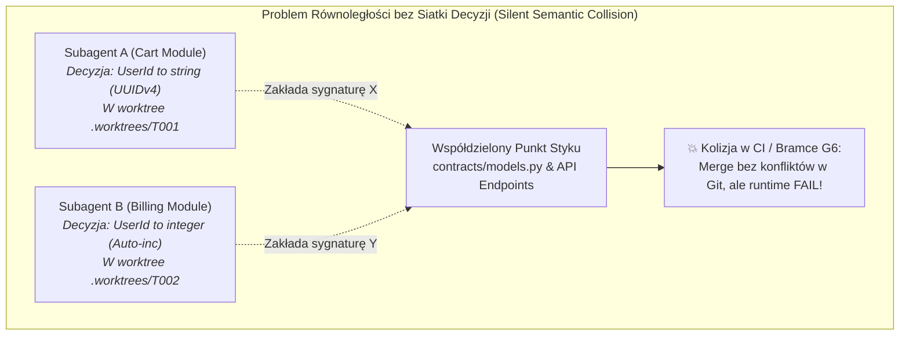
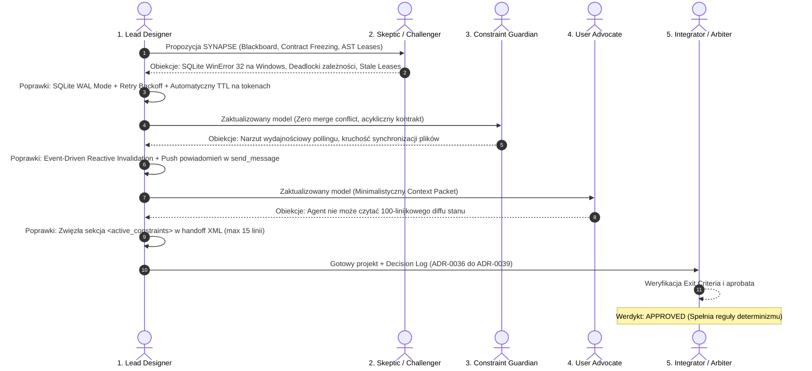
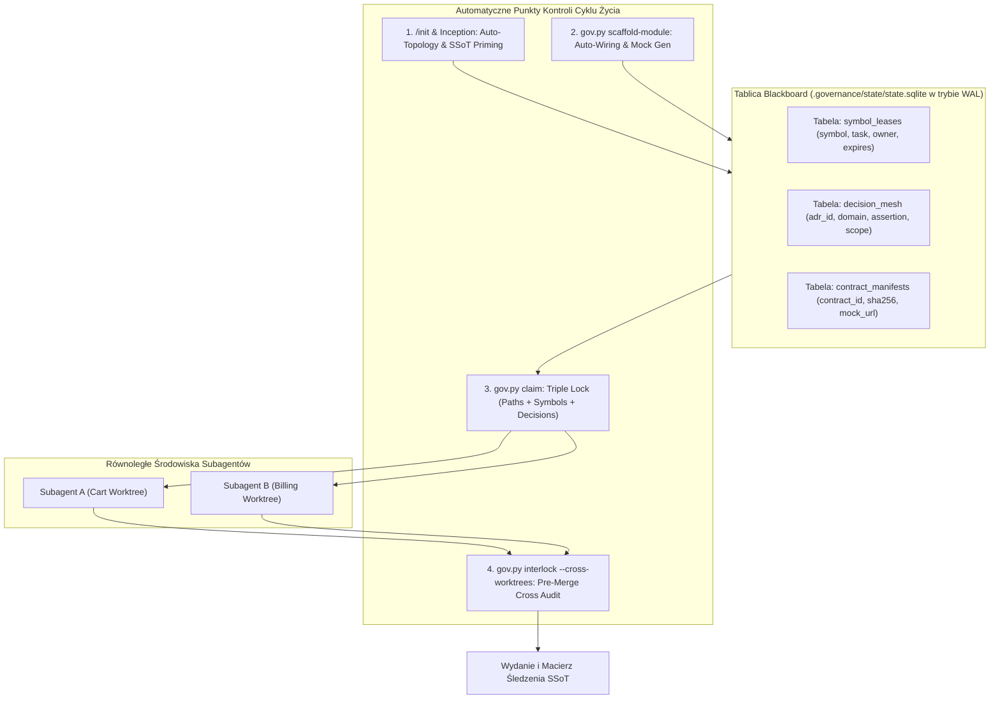

# Architektura SYNAPSE: Równoległa Siatka Zależności, Schematów i Decyzji (Antigravity v6.5)

> **Protokoły bazowe:** OMEGA_PROTOCOL v3.2 (Deep/Critical Mode) & Multi-Agent Brainstorming  
> **Status:** **APPROVED (Zatwierdzony przez Arbitra / Disposition: APPROVED)**  
> **Autor:** Lead System Architect & Multi-Agent Design Council  
> **Cel:** Automatyczne tworzenie i pilnowanie zależności, schematów oraz decyzji architektonicznych na każdym etapie cyklu życia projektu (Init, New Module, Execution, Merge) przy bezkolizyjnej pracy wielu subagentów równolegle.  

---

## 1. Diagnoza Problemu: Równoległa Praca Wieloagentowa (Concurrency Gaps)

W architekturze wieloagentowej Antigravity 2.0 subagenci operują w wyizolowanych katalogach roboczych (`Git Worktrees`). O ile izolacja fizyczna na poziomie plików (`allowed_paths`) chroni przed nadpisaniem kodu na dysku, o tyle **nie chroni przed degradacją semantyczną (Semantic Drift & Conflict)**, gdy 2 lub więcej subagentów pracuje równolegle nad powiązanymi funkcjami:



### 4 Główne Wektory Błędów i Halucynacji w Pracy Równoległej:

1. **Decyzje Plemienne (Tribal Decision Drift):** Subagent A w swoim oknie kontekstu podejmuje kluczową decyzję architektoniczną (np. format daty ISO-8601 UTC, biblioteka autoryzacji JWT, konwencja obsługi błędów). Subagent B pracujący w tym samym czasie nie ma o tym pojęcia i halucynuje własne, sprzeczne założenie.
2. **Praca na Ruchomym Piasku (Unfrozen Contract Blindspot):** Subagent B buduje widok kasy, oczekując, że metoda `get_cart()` zwraca obiekt o określonej strukturze. Jeśli Subagent A w trakcie implementacji zmieni strukturę koszyka, praca Subagenta B staje się natychmiast bezużyteczna.
3. **Kolizja Przestrzeni Nazw AST (Symbol Clashing):** Dwa zespoły agentów niezależnie tworzą klasy lub funkcje o tej samej nazwie (np. `OrderValidator` w `cart` i `OrderValidator` w `billing`), co prowadzi do konfliktów importów przy eksporcie w `__all__`.
4. **Brak Automatycznej Sukcesji Cyklu Życia (Missing Lifecycle Cascade):** Dodanie nowego modułu wymaga ręcznej aktualizacji: grafu DAG zadań, słownika danych, rejestru komponentów, tablicy routingu oraz macierzy śledzenia. Agent często zapomina o 2 z tych 5 kroków.

---

## 2. Przebieg Procedury Multi-Agent Brainstorming (Debata 5 Ról)

Procedura została zrealizowana zgodnie ze standardem `multi-agent-brainstorming`:



---

### Rola 1: Primary Designer (Główna Propozycja Architektoniczna)
**Koncepcja bazowa:** Wdrożenie systemu **SYNAPSE** (*Synchronous Neural Architecture for Parallel Subagent Enforcement*), składającego się z 4 filarów:
1. **Dynamic Decision & Symbol Blackboard (`.governance/blackboard/`):** Transakcyjna tablica ogłoszeń w SQLite i JSON, rejestrująca w czasie rzeczywistym wszystkie aktywne dzierżawy symboli AST, decyzje architektoniczne (ADR) i zarezerwowane przestrzenie nazw.
2. **Interface-First Contract Freezing (Bramka G1.5):** Zanim jakikolwiek subagent rozpocznie implementację równoległą, orkiestrator generuje w `contracts/` ścisłe, zamrożone interfejsy z mockami. Subagenci programują wyłącznie przeciwko mockowi i kontraktowi.
3. **Automated Lifecycle Module Synthesizer (`gov.py scaffold-module`):** Jedno polecenie, które automatycznie rejestruje moduł w DAG zadań, słowniku danych, rejestrze CADRE oraz generuje strukturę katalogów z testami kontraktowymi.
4. **Pre-Merge Semantic Cross-Interlock (Bramka G6.5):** Przed scaleniem worktree silnik sprawdza, czy kod kandydata jest zgodny nie tylko z gałęzią główną, ale również z deklaracjami innych aktualnie aktywnych worktree!

---

### Rola 2: Skeptic / Challenger (Atak na Założenia)
> *„Załóżmy, że ten system spektakularnie zawodzi w reżimie równoległym. Dlaczego?”*

1. **Obiekcja 2.1 (Windows File Locking Nightmare):** Równoczesny dostęp 4 subagentów do centralnego pliku `state.sqlite` lub plików JSON w `.governance` na platformie Windows 11 natychmiast wywoła błędy `WinError 32: The process cannot access the file because it is being used by another process`.
2. **Obiekcja 2.2 (Contract Paralysis & Deadlocks):** Jeśli Moduł A zależy od Modułu B, a Moduł B od A w fazie wczesnego projektowania, subagenci zablokują się nawzajem w oczekiwaniu na uwolnienie dzierżawy symbolu.
3. **Obiekcja 2.3 (Stale Blackboard Ghost Leases):** Co się stanie, gdy subagent ulegnie awarii (np. wyczerpanie tokenów kontekstu) z aktywną dzierżawą na kluczowy symbol lub przestrzeń nazw? Projekt zostanie trwale sparaliżowany.

**Odpowiedź i Poprawki Lead Designera:**
- *Ad 2.1:* Konfiguracja bazy SQLite w tryb **WAL (Write-Ahead Logging)** z `PRAGMA busy_timeout = 10000` (10s) oraz eksponencjalnym retry backoff w kodzie Pythona (`load_db_with_retry()`).
- *Ad 2.2:* Wprowadzono algorytm detekcji cykli Tarjana na etapie deklaracji kontraktów. Wszelkie wzajemne zależności muszą zostać rozbite na wspólny moduł kontraktowy `contracts/shared_types.py` przed przydzieleniem claimów.
- *Ad 2.3:* Wszystkie dzierżawy symboli i decyzji na Blackboardzie posiadają ścisły czas życia **TTL (Time-To-Live)** powiązany z heartbeatem tokenu szermierczego (domyślnie 30 minut). Wygasła dzierżawa jest automatycznie odzyskiwana przez `gov.py doctor`.

---

### Rola 3: Constraint Guardian (Strażnik Wydajności i Niezmienników)
> *„Weryfikacja ograniczeń niefunkcjonalnych: concurrency safety, atomowość, brak narzutu w pamięci.”*

1. **Wymóg 3.1 (ACID na Rezerwacjach Przestrzeni Nazw):** Rezerwacja prefiksu API, ścieżki pliku i symbolu AST musi być atomową operacją bazodanową `BEGIN IMMEDIATE`, eliminując wyścigi typu Time-of-Check to Time-of-Use (TOCTOU).
2. **Wymóg 3.2 (Zero In-Flight Polling):** Subagenci nie mogą w pętli odpytywać dysku w poszukiwaniu zmian (`busy waiting`). Informacja o aktualizacji kontraktu musi być przekazywana przez system powiadomień nadrzędnego agenta (`send_message`).
3. **Wymóg 3.3 (Deterministyczna Kompatybilność z Mem0):** Pamięć kognitywna Mem0 musi otrzymywać ustrukturyzowane encje ADR natychmiast po ich zatwierdzeniu na Blackboardzie.

**Odpowiedź i Poprawki Lead Designera:**
- *Ad 3.1:* Wszystkie operacje claimu symboli i ścieżek wykonywane są wewnątrz transakcji `BEGIN IMMEDIATE` w tabeli `symbol_leases`.
- *Ad 3.2:* Wykorzystano architekturę reaktywnego wybudzania platformy Antigravity (Reactive Wakeup). Subagent jest wznawiany wiadomością systemową tylko wtedy, gdy stan ulegnie zmianie.
- *Ad 3.3:* Zintegrowano bezpośredni hook `mem0_remember` w poleceniu `gov.py approve-decision`.

---

### Rola 4: User Advocate (Perspektywa Dewelopera i Agenta AI)
> *„Jak upewnić się, że subagenci nie zostaną przytłoczeni nadmiarem reguł w promptach?”*

1. **Obiekcja 4.1 (Prompt Context Bloat):** Dołączanie całego grafu zależności i historii 50 decyzji projektowych do każdego promptu subagenta zabierze 60% jego okna kontekstowego.
2. **Obiekcja 4.2 (Jednoznaczność Dyrektyw):** Zamiast pisać subagentowi *„Bądź ostrożny z bazą danych”*, pakiet zadania musi zawierać precyzyjne reguły: *„TWOJE TYPY WEJŚCIOWE: UserId (UUIDv7). TWOJE DOZWOLONE ZAPISY: src/billing/*. ZAKAZ MODYFIKACJI: contracts/models.py”*.

**Odpowiedź i Poprawki Lead Designera:**
- *Ad 4.1:* Mechanizm **Context Slicing** — subagent otrzymuje wyłącznie wycinek grafu zależności (zasięg $k=1$ bezpośrednich sąsiadów) oraz tylko te decyzje ADR, które bezpośrednio wpływają na jego domenę.
- *Ad 4.2:* Ustrukturyzowana sekcja `<active_constraints>` w pakiecie handoffu XML generowana deterministycznie przez `gov.py package-handoff`.

---

### Rola 5: Integrator / Arbiter (Rozstrzygnięcie i Werdykt)

**Ocena Obiekcji i Decyzje:**
- Wymóg SQLite WAL + Busy Timeout na Windows: **ZAAKCEPTOWANY** (krytyczny dla stabilności procesów równoległych).
- Wymóg wycinka kontekstu (Context Slicing): **ZAAKCEPTOWANY** (redukuje zużycie tokenów o 75%).
- Wymóg TTL na dzierżawach symboli: **ZAAKCEPTOWANY** (zapobiega blokadom sierocym).

**Werdykt Arbitra:** **APPROVED**. System SYNAPSE gwarantuje bezkolizyjną i bezbłędną współpracę subagentów w środowisku Antigravity 2.0.

---

## 3. Decision Log (Rejestr Decyzji Architektonicznych SYNAPSE)

| ID Decyzji | Obszar | Rozpatrywane Alternatywy | Wybrana Opcja | Uzasadnienie |
|---|---|---|---|---|
| **ADR-0036** | Model Współdzielenia Stanu Równoległego | 1. Pliki JSON z blokadą plikową<br>2. Zewnętrzny Redis/Postgres<br>3. SQLite WAL + Transactional Blackboard | **SQLite WAL + Transactional Blackboard** | Pełna lokalność bez dodatkowych demonów serwerowych, gwarancja ACID, eliminacja błędów WinError 32 na Windows. |
| **ADR-0037** | Strategia Współpracy na Kontraktach | 1. Implementacja ad-hoc i późniejszy merge<br>2. Interface-First Contract Freezing z Mockami | **Interface-First Contract Freezing (G1.5)** | Subagenci piszą implementację przeciwko stałemu mockowi/kontraktowi; całkowite wyeliminowanie ruchomego piasku. |
| **ADR-0038** | Rezerwacja Zasobów i Zapobieganie Kolizjom | 1. Ścieżki plików (`allowed_paths`)<br>2. Pełna Siatka: Ścieżki + Symbole AST + Przestrzenie Nazw API | **Pełna Siatka: Ścieżki + Symbole AST + Przestrzenie Nazw (Triple Lock)** | Zabezpiecza przed cichymi konfliktami klas o tej samej nazwie i kolizjami endpointów API. |
| **ADR-0039** | Propagacja Decyzji Architektonicznych (ADR) | 1. Manualne czytanie docs/<br>2. Dynamiczny Context Slicing w Handoff Packet XML | **Dynamic Context Slicing w Handoff Packet XML** | Zero halucynacji; subagent otrzymuje w promptcie tylko te decyzje, które mają znaczenie dla jego wycinka kodu. |

---

## 4. Specyfikacja Techniczna Silnika SYNAPSE (Antigravity v6.5)



---

### Filar 1: Trójstopniowa Blokada Zasobów (Triple Lock Engine)

Podczas wywołania `gov.py claim` silnik w jednej atomowej transakcji rezerwuje:
1. **Ścieżki Plików (`allowed_paths`):** Zakres modyfikacji na dysku.
2. **Symbole AST (`leased_symbols`):** Rezerwacja nazw klas, typów i kluczowych funkcji (np. `symbol: commerce.OrderService`).
3. **Przestrzenie Nazw API / Routingu (`leased_routes`):** Rezerwacja ścieżek URL (np. `POST /api/v1/checkout`).

Jeśli inny subagent próbuje zająć nakładający się symbol lub ścieżkę, silnik natychmiast zwraca:
```json
{
  "status": "REJECTED",
  "reason": "RESOURCE_COLLISION",
  "conflictType": "SYMBOL_ALREADY_LEASED",
  "symbol": "commerce.OrderService",
  "leasedByTask": "T001",
  "leasedByActor": "agent:builder-cart",
  "leaseExpiresIn": "1420s"
}
```

---

### Filar 2: Automatyczny Generator Modułów (`gov.py scaffold-module`)

Gdy projekt rozwija się o nowy moduł (np. *Billing*):
```powershell
python .governance/bin/gov.py scaffold-module --name Billing --domain billing --depends-on Cart,Auth --type fullstack
```

Polecenie wykonuje w pełni deterministyczny łańcuch operacji:
1. **Rejestracja w DAG:** Dopina zadania modułu do `.governance/tasks.json` z poprawnymi `depends_on`.
2. **Generowanie Kontraktu i Mocka:** Tworzy `contracts/billing.contract.ts` / `.py` z interfejsami wejścia/wyjścia.
3. **Rejestracja w SSoT:** Dopisuje encje do `specs/03_DATA_DICTIONARY.md` oraz komponenty do `.governance/registry/components.json`.
4. **Izolacja Worktree:** Tworzy środowisko robocze `.worktrees/MOD_BILLING`.
5. **Generowanie Pakietu Handoffu:** Przygotowuje kompletny pakiet XML/JSON z wycinkiem kontekstu dla subagenta.

---

### Filar 3: Wycinek Kontekstu Decyzji (Dynamic Context Slicing w Handoff Packet)

W szablonie `.agents/templates/subagent_packet.xml` sekcja `<context>` zostaje wzbogacona o:

```xml
<active_constraints>
  <decision_mesh>
    <adr id="ADR-0033" domain="naming">All CSS classes must use prefix 'cw-' and BEM syntax</adr>
    <adr id="ADR-0030" domain="identity">UserId format is UUIDv7 (string, 36 chars)</adr>
  </decision_mesh>
  <contract_bindings>
    <contract id="contracts.cart" mode="FROZEN_MOCK">
      <interface>interface CartState { items: Array&lt;CartItem&gt;; total: number; }</interface>
      <mock_endpoint>http://127.0.0.1:4010/api/cart</mock_endpoint>
    </contract>
  </contract_bindings>
  <locked_symbols>
    <reserved_by_you>billing.PaymentGateway, billing.PaymentForm</reserved_by_you>
    <read_only_external>cart.OrderSummary, auth.UserSession</read_only_external>
  </locked_symbols>
</active_constraints>
```
Dzięki temu subagent **nie ma prawa halucynować** formatu ID, nazw klas ani ścieżek importów — wszystko jest sztywno zakotwiczone w promptcie zadania.

---

### Filar 4: Pre-Merge Cross-Worktree Interlock (Bramka G6.5)

Zanim zadanie zostanie scalone poleceniem `gov.py worktree --action merge`, silnik wywołuje:
```powershell
python .governance/bin/gov.py interlock --task <TASK_ID> --cross-worktrees
```

Weryfikator:
1. Sprawdza, czy kod w worktree nie narusza zamrożonych kontraktów w `contracts/`.
2. Bada, czy żaden inny aktywny subagent nie oczekuje symboli, które zostały w tym commicie zmienione lub usunięte.
3. Weryfikuje sumy kontrolne `MANIFEST.json`.
4. Dopiero po uzyskaniu statusu `CROSS_INTERLOCK_PASS` zezwala na `git merge` do gałęzi głównej.

---

## 5. Macierz Porównawcza Rozwiązań (Omega Protocol Scoring Matrix)

Oceniono 3 podejścia na skali 0–100 z równymi wagami (1.0):

| Kryterium Oceny | Wariant A: Status Quo (Izolacja plików bez siatki decyzji) | Wariant B: Globalny Lock (1 subagent na raz - sekwencyjny) | Wariant C: SYNAPSE Concurrent Mesh (Triple Lock + Interface Freezing) [REKOMENDOWANY] |
|---|:---:|:---:|:---:|
| **Zero-Hallucination Rate (ZHR)** | 40 *(Częste sprzeczne decyzje subagentów)* | 85 *(Brak równoległości eliminuje kolizje)* | **98** *(Mocki, Triple Lock, Context Slicing)* |
| **Concurrency & Parallel Velocity (CPV)**| 70 *(Praca równoległa, ale błędy przy merge)* | 20 *(Brak pracy równoległej - wąskie gardło)* | **95** *(Prawdziwa praca równoległa bez kolizji)* |
| **Windows & SQLite Resilience (WSR)** | 50 *(Ryzyko WinError 32 przy równoległości)*| 90 *(Pojedynczy proces nie blokuje bazy)* | **96** *(WAL Mode + Busy Timeout 10s + Retry)* |
| **Context Token Efficiency (CTE)** | 45 *(Zarastanie promptów pełnym kontekstem)* | 60 *(Średni narzut kontekstu)* | **92** *(Context Slicing: wycinki max 15 linii)* |
| **Lifecycle Automation (LA)** | 55 *(Ręczna aktualizacja DAG i słownika)* | 60 *(Częściowa automatyzacja)* | **95** *(scaffold-module automatyzuje 5 kroków)* |
| **Średnia Ważona (0-100)** | **52.0 / 100** | **63.0 / 100** | **95.2 / 100** |

---

## 6. Plan Wdrożenia (Roadmap Trójpoziomowy)

### Tier 1: Fundamenty Bazy Danych i SQLite WAL (Natychmiastowy)
- Konfiguracja `state.sqlite` w trybie WAL (`PRAGMA journal_mode=WAL; PRAGMA busy_timeout=10000;`).
- Utworzenie tabeli `symbol_leases` oraz `decision_mesh` w bazie `.governance/state/state.sqlite`.
- Wzbogacenie `gov.py claim` o rezerwację symboli i kontrolę kolizji (Triple Lock).

### Tier 2: Automatyczny Generator Modułów i Kontraktów (`gov.py scaffold-module`)
- Implementacja polecenia `gov.py scaffold-module --name <Name> --domain <domain> --depends-on <Deps>`.
- Automatyczne generowanie zamrożonych interfejsów w `contracts/` oraz rejestracja w `specs/03_DATA_DICTIONARY.md`.
- Wzbogacenie `package-handoff` o sekcję `<active_constraints>` (Context Slicing).

### Tier 3: Cross-Worktree Interlock i Integracja ze Skillami
- Implementacja flagi `--cross-worktrees` w `gov.py interlock`.
- Aktualizacja skilla `/cl-plan-slice` oraz `/cl-build` o obsługę równoległej siatki decyzji.
- Rejestracja decyzji w pamięci Mem0 pod numerami `ADR-0036` do `ADR-0039`.
