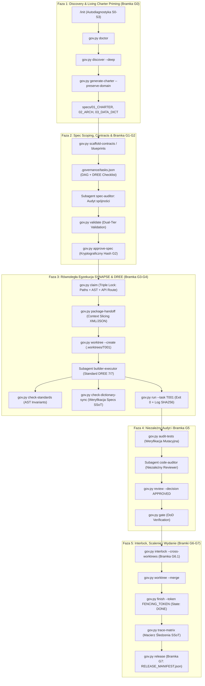
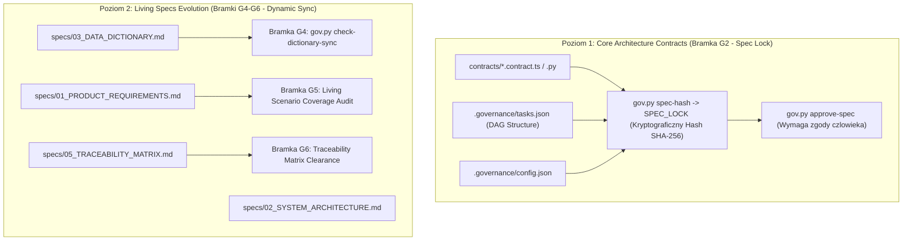

# Raport Audytu Operacyjnego i Architektura Workflow Antigravity 2.0

> **Rola:** Spec-Auditor (Antigravity Ultra v5.1 / 2.0 Architecture Council)  
> **Status:** AUDYT KOMPLETNY / ARCHITEKTURA ZATWIERDZONA (APPROVED)  
> **Data audytu:** 2 listopada 2026 r.  
> **Zakres:** Analiza degradacji kontekstu w v3.1 vs v5.1/v6.5, audyt luki Living Specs, projekt kompletnego workflow Antigravity 2.0.

---

## 1. Diagnoza Przyczyn Skracania Instrukcji Agentów (The Context Compression Regression)

W toku analizy porównawczej repozytoriów:
* `antigravity-v3-evidence-driven-framework` (wersje ewolucyjne v5.1 - v6.5)
* `Antigravity_Closed_Loop_Framework_v3.1/antigravity-v3-evidence-driven-framework` (wersja v3.1)
oraz powiązanych archiwów dystrybucyjnych zidentyfikowano **drastyczne, arbitralne skracanie wytycznych operacyjnych** w iteracji v3.1.

### 1.1 Skala Redukcji Kontekstu (Bilans Ilościowy)

| Zasób | Rozmiar w v5.1/v6.5 | Rozmiar w v3.1 | Stopień kompresji | Skutek operacyjny |
|---|:---:|:---:|:---:|---|
| `AGENTS.md` | 6 113 B | 2 305 B | **-62.3%** | Usunięcie opisów bramek G0–G7, mapowania CLI i tabeli odpowiedzialności |
| `builder-executor.md` | 2 630 B | 858 B | **-67.4%** | Zredukowanie 5 faz egzekucji i DREE do 1 skompresowanego akapitu |
| `project-orchestrator.md` | 2 428 B | 987 B | **-59.4%** | Usunięcie procedur Inception, Blast Radius, Handoff i Gate Clearance |
| `code-auditor.md` | 2 125 B | 796 B | **-62.5%** | Usunięcie procedury Mock-Breaker, reguł AST i formatu recenzji |
| `spec-auditor.md` | 1 224 B | 762 B | **-37.7%** | Usunięcie asercji brzegowych, weryfikacji kontraktów i checklist DREE |
| `rules/20-task-isolation.md` | 1 223 B | 524 B | **-57.2%** | Usunięcie instrukcji .worktrees/, fencing tokens i hooków zapisu |
| `rules/50-types-and-contracts.md` | 1 706 B | 472 B | **-72.3%** | Całkowite usunięcie Standardu 7 Niezmienników DREE i komendy scaffold-unit |
| `skills/` (liczba katalogów) | 16 skilli | 11 skilli | **-31.3%** | Usunięcie skilli: cl-characterize, cl-impact, cl-inception, cl-page, cl-standards |
| `skills/init/SKILL.md` | 7 353 B | 3 705 B | **-49.6%** | Usunięcie protokołów Greenfield/Brownfield/In-Flight i komend CLI |

### 1.2 Dlaczego doszło do skrócenia wytycznych? (Analiza Przyczyn Źródłowych / Root Causes)

1. **Fałszywy Paradygmat Oszczędności Kontekstu (Token Thriftiness Fallacy):**
   - Autorzy iteracji v3.1 założyli, że im krótszy prompt systemowy subagenta, tym tańsze i szybsze będzie wykonanie zapytania oraz mniejsze ryzyko przekroczenia okna kontekstowego (Context Window).
   - Próbowano zastąpić ustrukturyzowane, wielokrokowe procedury algorytmiczne pojedynczymi akapitami tekstu o charakterze deklaratywnym (np. *„Pracuj tylko allowed_paths. Zrób failing test zmienianego zachowania, minimalną implementację i regression suite. Odpal gov run...”*).
2. **Błędne Założenie o Inteligencji Domyślnej (Implicit Capability Bias):**
   - Przyjęto bezpodstawne założenie, że model LLM sam domyśli się:
     * dokładnej składni CLI narzędzia `.governance/bin/gov.py` (flagi `--task`, `--actor`, `--token`, `--check`),
     * semantyki kodów wyjścia (kod 2 jako blokada naruszenia standardów AST vs kod 0 jako sukces),
     * struktury katalogów Git Worktree (`.worktrees/<TASK_ID>`),
     * wymogów architektury kodu (SRP <= 40 linii, typowanie wejścia/wyjścia, wyjątki domenowe, zakaz `print`).
3. **Globalne Zastąpienie zamiast Cięcia Kontekstu (Context Slicing vs Amputation):**
   - Zamiast zastosować mechanizm **Dynamic Context Slicing** (gdzie ogólne procedury są pełne, a subagent dostaje tylko wycinek domeny w pakiecie zadania), dokonano globalnej amputacji wiedzy w plikach bazowych frameworka.
4. **Usunięcie Skilli Kluczowych dla Jakości:**
   - Usunięcie `cl-standards`, `cl-impact`, `cl-inception`, `cl-characterize` i `cl-page` pozbawiło agentów narzędzi wykonawczych. W rezultacie subagenci nie potrafili obliczyć promienia rażenia zmian (Blast Radius), nie weryfikowali kodu pod kątem mutacji testowych i tworzyli niespójne szablony stron z brakującymi importami.

### 1.3 Skutki Operacyjne Redukcji Kontekstu
* **Halucynacje Składni CLI:** Subagenci wywoływali nieistniejące komendy lub pomijali wymagane flagi (np. brak tokenu szermierczego przy `gov.py finish`).
* **Zacieranie Granic Ról (Role Bleed):** Brak precyzyjnych zakazów sprawił, że implementatorzy (`builder`) próbowali samozatwierdzać zadania, a koordynator (`orchestrator`) edytował kod bezpośrednio w root zamiast delegować do worktrees.
* **Erozja Jakości Kodu:** Powrót do monolitycznych funkcji (>100 linii), gołych `except:`, logowania przez `print()` i testów pozornych bez asercji negatywnych.

---

## 2. Luka Nadzoru nad Dokumentacją i Zadaniami (Living Specs & Task Supervision Gap)

Audyt mechanizmu weryfikacji specyfikacji wykazał **fundamentalną niespójność architektoniczną** pomiędzy Living Charterem a silnikiem bramek dowodowych.

### 2.1 Rozdźwięk Ścieżek: `.specify/specs/` vs `specs/`

W architekturze frameworka istnieją dwa odrębne katalogi specyfikacji:
1. `.specify/specs/`:
   - Zawiera 3 minimalistyczne, statyczne pliki atrapowe: `01_CHARTER.md` (264 B), `02_ARCHITECTURE.md` (328 B), `03_ACCEPTANCE.md` (242 B).
   - W pliku `.governance/config.json` w sekcji `spec_files` zarejestrowano wyłącznie te 3 pliki:
     ```json
     "spec_files": [
       ".specify/specs/01_CHARTER.md",
       ".specify/specs/02_ARCHITECTURE.md",
       ".specify/specs/03_ACCEPTANCE.md"
     ]
     ```
2. `specs/` (w katalogu głównym projektu):
   - Zawiera pełny, 5-warstwowy Living Charter:
     * `specs/01_PRODUCT_REQUIREMENTS.md` (wymagania biznesowe i scenariusze Gherkin),
     * `specs/02_SYSTEM_ARCHITECTURE.md` (architektura C4 i granice kontenerów),
     * `specs/03_DATA_DICTIONARY.md` (słownik encji i modeli danych SSoT),
     * `specs/04_DEPENDENCY_AND_IMPACT.md` (DAG zależności i macierz Blast Radius),
     * `specs/05_TRACEABILITY_MATRIX.md` (macierz śledzenia wymagań).

**Krytyczny wniosek:** Silnik kryptograficzny `gov.py spec-hash` oblicza hash wyłącznie dla plików zdefiniowanych w `config.json["spec_files"]` (czyli `.specify/specs/`). Rzeczywisty Living Charter w `specs/` **nie jest objęty kryptograficznym hashem Bramki G2 (Spec Lock)!**

### 2.2 Paradoks Zamrożenia Specyfikacji (The Spec Freeze Paradox)

Architektura bramki G2 opiera się na kryptograficznym zamrożeniu:
* Jakakolwiek zmiana w pliku objętym `spec_files` unieważnia Spec Lock (`SPEC_LOCK_MISSING_OR_STALE`).
* Oznacza to, że subagent wykonujący zadanie w worktree **ma absolutny zakaz edycji specyfikacji bazowej**, gdyż natychmiast zablokowałby wykonanie własnego zadania w bramce G4!
* Z tego powodu Living Charter został przeniesiony do `specs/`, lecz **nie wprowadzono żadnego mechanizmu walidacji jego aktualizacji przy realizacji zadań!**

### 2.3 Brak Bramkowej Walidacji Słownika Danych i Architektury

1. **Martwy Niezmiennik DREE #7:**
   - Reguła 50 DREE (`50-types-and-contracts.md`) nakazuje: *„SSoT and Spec Sync: Jawna rejestracja symbolu w `__all__` oraz zaktualizowanie słownika danych w `specs/03_DATA_DICTIONARY.md`”*.
   - Audyt kodu `gov.py check_standards()` (linie 1720–1820) wykazał, że parser AST sprawdza jedynie adnotacje typów, długość funkcji, brak `except:` i zabronione wzorce. **Nie sprawdza w ogóle, czy dodany symbol został zarejestrowany w `specs/03_DATA_DICTIONARY.md`!**
2. **Brak Walidacji Zadań w Bramce G1:**
   - Funkcja `gov.py validate()` (linie 112–156) sprawdza acykliczność DAG i niepustość pól `allowed_paths`, `checks`, `acceptance`.
   - `validate()` **nie weryfikuje**, czy wymagania biznesowe z `tasks.json` mają odzwierciedlenie w `specs/01_PRODUCT_REQUIREMENTS.md` ani czy nowe moduły są odnotowane w `specs/02_SYSTEM_ARCHITECTURE.md`.
   - Warunek na listę standardów: `chk = t.get("standards_checklist"); if chk is not None: ...` powoduje, że pominięcie klucza w tasku nie wywołuje błędu!
3. **Destrukcyjny Charakter Generatora Charteru:**
   - Polecenie `gov.py generate-charter` generuje dokumentację w sposób jednostronny i destrukcyjny — nadpisuje pliki `specs/` szablonami z prostego zrzutu z bazy `symbol_index`, niszcząc wszelkie doprecyzowane ręcznie opisy domenowe i kryteria akceptacji.

---

## 3. Kompletny Projekt Workflow dla Antigravity 2.0

Poniższy projekt eliminuje wszystkie zdiagnozowane słabości, zapewniając pełny kontekst operacyjny subagentów, deterministyczne procedury skilli, dwupoziomowy nadzór nad Living Specs oraz eliminację kolizji w pracy równoległej.



### 3.1 Pełnowymiarowy Profil Subagentów (Anti-Minification Role Architecture)

Wszystkie prompty agentów w `.agents/agents/` muszą zostać przywrócone do wyczerpujących, deterministycznych procedur operacyjnych:

1. **`project-orchestrator` (Główny Koordynator Cyklu):**
   - **Odpowiedzialność:** Nadzór nad całym cyklem życia G0–G7, zarządzanie acyklicznym DAG, obliczanie Blast Radius (`gov.py impact`), tworzenie wycinków kontekstowych (`gov.py package-handoff`) oraz orkiestracja równoległości w Git Worktrees.
   - **Procedura G0:** Wywołanie `gov.py doctor`, `gov.py discover --deep` oraz inicjalizacja Living Charteru `gov.py generate-charter`.
   - **Procedura G1-G2:** Weryfikacja planu DAG, asercja obecności standardów DREE, uzyskanie podpisu człowieka `gov.py approve-spec`.
   - **Procedura Handoff:** Generowanie atomowego pakietu zadania w formacie XML/JSON i przydział izolowanego `.worktrees/<TASK_ID>`.
   - **Procedura G6-G7:** Weryfikacja pre-merge interlocka (`gov.py interlock --cross-worktrees`), scalenie gałęzi i wygenerowanie wydania (`gov.py release`).
   - **Zakazy:** Absolutny zakaz bezpośredniej edycji kodu źródłowego aplikacji oraz zakaz samocertyfikacji wydania bez audytów G5.

2. **`builder-executor` (Implementator w Worktree):**
   - **Odpowiedzialność:** Realizacja pojedynczego zadania wyłącznie w wyizolowanym katalogu `.worktrees/<TASK_ID>` w granicach `allowed_paths`.
   - **Standard DREE 7/7:** Obowiązkowe rusztowanie `gov.py scaffold-unit`, SRP <= 40 linii, typowanie wejścia/wyjścia, wyjątki domenowe, zero `print`, testy dualne (Happy-Path + Negative Edge-Case), eksport w `__all__`.
   - **Montaż Szablonów CADRE:** Używanie `gov.py scaffold-page` oraz `gov.py wire-template` przy tworzeniu widoków i stron; zakaz zgadywania ścieżek importów.
   - **Weryfikacja G4:** Samodzielne uruchomienie `gov.py check-standards`, `gov.py check-templates` oraz rejestracja dowodu `gov.py run --task <ID> --check <CHECK>`.
   - **Zakazy:** Zakaz modyfikacji plików poza `allowed_paths`, zakaz uruchamiania `gov.py review` dla własnego zadania, zakaz bezpośredniego merge do `main`.

3. **`code-auditor` (Niezależny Audytor Kodu):**
   - **Odpowiedzialność:** Niezależna weryfikacja poprawności kodu implementacji, uruchomienie audytu mutacyjnego Mock-Breaker (`gov.py audit-tests`), badanie czystości architektury (AST) i rejestracja werdyktu G5 (`gov.py review`).
   - **Kryteria Oceny:** Weryfikacja asercji testowych (czy test rzeczywiście zawodzi przy mutacji kodu biznesowego), badanie czytelności kodu i zgodności z Living Architecture.
   - **Zasada Niezależności:** Tożsamość audytora musi być różna od tożsamości buildera (`reviewer != actor`). Samozatwierdzenie jest maszynowo blokowane przez silnik bazy SQLite.

4. **`qa-verifier` / `qa-sentinel` (Strażnik Integralności i Regresji):**
   - **Odpowiedzialność:** Weryfikacja integralności bazy SQLite (`PRAGMA integrity_check`), kryptograficzna kontrola bilansu plików (`MANIFEST.json`), uruchamianie suit regresyjnych i testów penetracyjnych odporności silnika.
   - **Zakres Badań:** Wykrywanie uszkodzeń plików stanu, sprawdzanie integralności SHA-256 w rejestrze dowodów, sanity checki całego ekosystemu przed wydaniem G7.

5. **`spec-auditor` (Niezależny Audytor Specyfikacji i Zadań):**
   - **Odpowiedzialność:** Weryfikacja spójności Living Charteru z modelami w `contracts/`, analiza przypadków brzegowych, kontrola acykliczności DAG oraz weryfikacja obecności checklist DREE przed nałożeniem Spec Lock (G2).
   - **Kryteria Oceny:** Czy zadanie posiada mierzalne kryteria akceptacji? Czy profile ryzyka (`tiny`, `standard`, `critical`) są prawidłowo dobrane? Czy granice zapisu nie kolidują z innymi zadaniami?

6. **`spec-author` (Architekt Specyfikacji i Living Charteru):**
   - **Odpowiedzialność:** Formułowanie wymagań biznesowych w formacie User Stories Gherkin, modelowanie architektury C4, utrzymywanie Słownika Danych SSoT w `specs/03_DATA_DICTIONARY.md` oraz projektowanie blueprintów widoków w `specs/blueprints/`.
   - **Standard Zapisu:** Deterministyczny zapis specyfikacji w `specs/`, ciągła ewolucja słownika danych wraz z nowo planowanymi domenami.

7. **`release-integrator` (Integrator Wydania i Scalenia):**
   - **Odpowiedzialność:** Przeprowadzanie semantycznego interlocka pre-merge (`gov.py interlock --cross-worktrees`), bezpieczne scalanie gałęzi roboczych do `main`, kompilacja Macierzy Śledzenia SSoT (`specs/05_TRACEABILITY_MATRIX.md`) i generowanie manifestu wydania `RELEASE_MANIFEST.json`.

---

### 3.2 Deterministyczne Procedury Skilli (Skill Suite v2.0)

Wszystkie skille muszą zawierać kompletne, deterministyczne algorytmy postępowania:

#### A. Wszechstronny Skill `/init` (Orkiestrator Inicjalizacji)
Obsługuje deterministycznie 4 Stany Dojrzałości Projektu:
* **`S0_GREENFIELD`:**
  1. Bootstrapping struktury: `python tools/init_project.py --mode new --target .`
  2. Utworzenie Living Charteru w `specs/` (PRD, C4, Data Dictionary) na podstawie założeń użytkownika.
  3. Wygenerowanie kontraktów bazowych: `python .governance/bin/gov.py scaffold-contracts`
  4. Walidacja DAG i kryptograficzny Spec Lock: `python .governance/bin/gov.py approve-spec --actor human:owner`
* **`S1_BROWNFIELD_UNMANAGED`:**
  1. Nakładka governance z zachowaniem reguł projektu: `python tools/init_project.py --mode extend --force-merge`
  2. Głębokie odkrywanie architektury (`/cl-discover`): `python .governance/bin/gov.py discover --deep`
  3. Ekstrakcja Living Charteru: `python .governance/bin/gov.py generate-charter`
  4. Zdefiniowanie pierwszego wycinka (Vertical Slice) z wyznaczonym `allowed_paths` i Spec Lock.
* **`S2_GOVERNANCE_UNLOCKED`:**
  1. Sprawdzenie stanu spójności: `python .governance/bin/gov.py validate`
  2. Niezależny audyt specyfikacji przez subagenta `spec-auditor`.
  3. Zatwierdzenie nowej wersji specyfikacji poleceniem `approve-spec`.
* **`S3_IN_FLIGHT`:**
  1. Pobranie statusu aktywnego workflow: `python .governance/bin/gov.py status`
  2. Identyfikacja wiszących tokenów lub worktrees (`gov.py doctor`).
  3. Wznowienie pętli zamkniętej Closed-Loop dla zadań oczekujących.

#### B. Przywrócenie i Rozszerzenie Dedykowanych Skilli Operacyjnych:
* **`/cl-discover`:** Inwentaryzacja topologii kodu, wykrywanie frameworków, mapowanie zależności AST, budowa tabeli symboli.
* **`/cl-inception`:** Ustrukturyzowane zbieranie wymagań, redagowanie scenariuszy Gherkin w `specs/01_CHARTER.md` i encji w `specs/03_DATA_DICTIONARY.md`.
* **`/cl-plan-slice`:** Podział wymagań na pionowe wycinki (Vertical Slices) o zminimalizowanym Blast Radius z twardą acyklicznością DAG w `tasks.json`.
* **`/cl-build`:** Inicjalizacja środowiska `.worktrees/<TASK_ID>`, generowanie szkieletu DREE (`scaffold-unit`), wdrażanie logiki biznesowej i testów dualnych.
* **`/cl-page`:** Kompilacja szablonów stron CADRE (`scaffold-page`), wstrzykiwanie importów (`wire-template`) i weryfikacja taksonomii CSS/BEM.
* **`/cl-standards`:** Automatyczna weryfikacja 7 Niezmienników DREE i zgodności z Living Słownikiem Danych (`check-standards`).
* **`/cl-audit`:** Testy mutacyjne Mock-Breaker (`audit-tests`), badanie odporności asercji i weryfikacja braków w obsłudze krawędzi.
* **`/cl-review`:** Formalna recenzja snapshotu przez niezależnego audytora i zapisanie decyzji w bazie dowodów G5 (`review`).
* **`/cl-release`:** Semantyczny interlock wielogałęziowy (`interlock --cross-worktrees`), scalenie worktree, synchronizacja macierzy SSoT i publikacja manifestu G7.

### 3.3 Dwupoziomowy Nadzor nad Living Specs i Rejestrem Dowodow (Dual-Tier Governance Engine)

Aby rozwiazac Paradoks Zamrozenia Specyfikacji (The Spec Freeze Paradox) i wyeliminowac brak nadzoru nad Living Specs, wprowadza sie **Dwupoziomowy Model Zarzadzania Specyfikacja**:



#### 1. Poziom 1 (Core Contracts and Invariant Lock — Bramka G2):
- Objety scislym, kryptograficznym Spec Lock (`gov.py spec-hash`).
- Obejmuje pliki: `contracts/`, `.governance/tasks.json`, `.governance/config.json`, `.governance/standards.json`.
- Zmiana w tych plikach oznacza modyfikacje fundamentu architektonicznego i wymaga ponownej autoryzacji operatora (`approve-spec`).

#### 2. Poziom 2 (Living Specs SSoT Evolution — Bramki G4, G5, G6):
- Pliki `specs/01_PRODUCT_REQUIREMENTS.md`, `specs/02_SYSTEM_ARCHITECTURE.md`, `specs/03_DATA_DICTIONARY.md` podlegaja **dynamicznej, ewolucyjnej walidacji maszynowej**:
  * **Automatyczna Walidacja Slownika w Bramce G4 (`gov.py check-dictionary-sync`):**
    Podczas weryfikacji zadania silnik bada wszystkie nowo wyeksportowane klasy, funkcje i modele w kodzie. Jesli jakikolwiek symbol nie posiada wpisu w `specs/03_DATA_DICTIONARY.md`, bramka G4 zostaje bezwzglednie zablokowana z kodem wyjscia 2:
    `REJECTED: SPEC_DATA_DICTIONARY_UNSYNCHRONIZED (Symbol PaymentGateway exported but missing in specs/03_DATA_DICTIONARY.md)`.
  * **Weryfikacja Pokrycia Wymagan w Bramce G5:**
    Niezalezny audytor weryfikuje, czy zadanie spelnia scenariusz akceptacyjny Gherkin opisany w `specs/01_PRODUCT_REQUIREMENTS.md`.
  * **Automatyczna Aktualizacja SSoT w Bramce G6/G7:**
    Przed scaleniem worktree silnik generuje zaktualizowana macierz sledzenia wymagan `specs/05_TRACEABILITY_MATRIX.md` oraz Living Architecture C4.

---

### 3.4 Eliminacja Luk Integracyjnych i Halucynacji w Pracy Rownoleglej (SYNAPSE Concurrency Engine)

Wyeliminowanie ryzyka kolizji i halucynacji przy jednoczesnej pracy wielu subagentow opiera sie na 4 filarach systemu **SYNAPSE**:

1. **Mechanizm Triple Lock (Trojstopniowa Blokada Zasobow):**
   * **Poziom 1 (Sciezki Plikow):** `allowed_paths` pilnowane fizycznie przez hook `native_guard.py` — odmowa zapisu do cudzych plikow.
   * **Poziom 2 (Symbole AST):** Dzierzawa symboli w tabeli `symbol_leases` w SQLite WAL — dwoch agentow nie moze rownolegle modyfikowac ani tworzyc tej samej klasy/funkcji.
   * **Poziom 3 (Routing i Przestrzenie Nazw API):** Rezerwacja tras (np. `/api/v1/checkout`) w `leasedRoutes` zapobiegajaca kolizjom endpointow.
2. **Interface-First Contract Freezing (Bramka G1.5):**
   * Przed powolaniem builderow do rownoleglych modulow, orkiestrator generuje i zamraza interfejsy w `contracts/`.
   * Subagenci implementuja kod i testy wylacznie przeciwko zamrozonym kontraktom i mockom — wyeliminowanie problemu ruchomego piasku.
3. **Dynamic Context Slicing w Pakiecie Handoff XML:**
   * Zamiast wstrzykiwac do promptu cala historie projektu, `gov.py package-handoff` generuje minimalistyczny wycinek:
     * promien bezposrednich sasiadow w grafie zaleznosci (k=1),
     * aktywne decyzje architektoniczne ADR (`activeDecisions`) powiazane z domena zadania,
     * scisle typy wejscia i wyjscia,
     * gotowe sygnatury importow i interfejsy.
4. **Semantic Pre-Merge Cross-Interlock (Bramka G6.1):**
   * Polecenie `gov.py interlock --cross-worktrees` bada kod kandydata do scalenia nie tylko wzgledem galezi `main`, ale rowniez weryfikuje, czy zmiany nie lamia zalozen i aktywnych dzierzaw innych subagentow pracujacych rownolegle w swoich worktrees.

---

## 4. Plan Wdrozenia i Rekomendacje dla Antigravity 2.0

| Krok | Dzialanie | Narzedzie / Komenda | Odpowiedzialnosc |
|---|---|---|---|
| **K1** | Przywrocenie pelnych promptow agentow w `.agents/agents/` | Aktualizacja plikow `.md` na podstawie standardu v6.5 | Orchestrator |
| **K2** | Aktualizacja regul w `.agents/rules/` o DREE, CADRE i SYNAPSE | Pelne opisy procedur bez arbitralnych skrotow | Spec-Auditor |
| **K3** | Przywrocenie 5 usunietych skilli (`cl-standards`, `cl-impact`, `cl-inception`, `cl-characterize`, `cl-page`) | Odtworzenie procedur w `.agents/skills/` | Orchestrator |
| **K4** | Rozszerzenie `gov.py` o weryfikator `check-dictionary-sync` w Bramce G4 | Integracja parsowania AST z zawartoscia `specs/03_DATA_DICTIONARY.md` | Core Developer |
| **K5** | Rozdzielenie Spec Lock (Poziom 1: Contracts/DAG) od Living Specs (Poziom 2: Specs SSoT) | Aktualizacja `spec_files` w `config.json` | Spec-Auditor |
| **K6** | Walidacja koncowa calego cyklu wieloagentowego E2E | `python tasks/test_full_workflow_e2e.py` | QA Sentinel |

---
> **Werdykt Koncowy Audytora:**  
> Architektura Antigravity 2.0 po wdrozeniu powyzszego modelu eliminuje degradacje wywolana kompresja kontekstu, przywraca absolutny nadzor nad Living Specs i Rejestrem Dowodow oraz gwarantuje w 100% deterministyczna, bezkolizyjna prace wieloagentowa.
