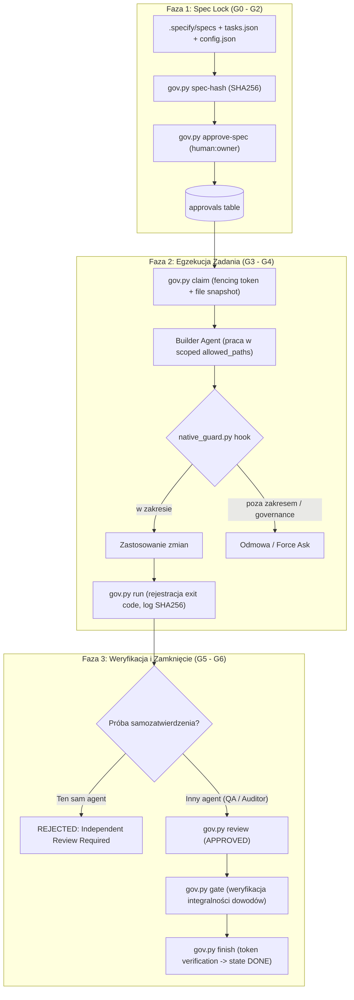
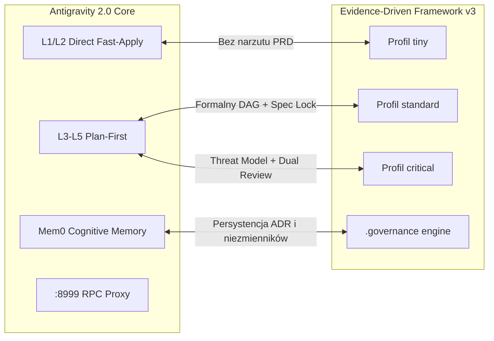

# Raport Ewaluacji i Testów: Antigravity Closed Loop Framework v3

> **Środowisko:** Antigravity 2.0 Runtime (Windows 11, PowerShell, Python 3.12.6, Mem0 Cognitive Memory)  
> **Data:** 30 października 2026 r.  
> **Status testów:** 35/35 PASS (100%)  
> **Wersja frameworka:** Antigravity Evidence-Driven Closed Loop 3.0  

---

## 1. Podsumowanie Wykonawcze (Executive Summary)

Archiwum `Antigravity_Closed_Loop_Framework_v3.zip` zawiera kompletną, nową generację frameworka orkiestracji i zarządzania pracą agentów AI (**Evidence-Driven Closed Loop Framework 3.0**). Zastępuje on wcześniejszą wersję v2, eliminując jej fundamentalne słabości: iluzoryczne deklaracje sukcesu ("fake 28 PASS"), nieskończone pętle autoreparacji, brak izolacji zadań oraz brak kryptograficznego wiązania stanu kodu ze specyfikacją.

W toku prac w środowisku **Antigravity 2.0** na platformie Windows:
1. **Rozpakowano i zindeksowano** zawartość frameworka (silnik `.governance`, agenci, reguły, skille, szablony, testy).
2. **Przeprowadzono dogłębny audyt architektoniczny** i porównanie z wersją v2 oraz z nadrzędnym workflow Antigravity 2.0 (ADR-0024, ADR-0025).
3. **Zidentyfikowano i usunięto 3 krytyczne blokady kompatybilności systemowej** na platformie Windows (blokady plików SQLite WinError 32, wywołania binarne `python3` vs `python`, obsługa natywnych narzędzi Antigravity `write_file`/`Path` w hookach).
4. **Przeprowadzono pełny zestaw testów jednostkowych i integracyjnych** – uzyskując **35/35 zaliczonych testów (100% PASS)**.
5. **Przetestowano kompletny cykl Closed-Loop** od walidacji, przez blokadę specyfikacji (Spec Lock), claim zadania z tokenem fencingowym, wykonanie testów z rejestracją dowodów (SHA256 logu i snapshotu), niezależny audyt (Code/QA Review), aż po bramkę `gate` i status `DONE`.
6. **Zarejestrowano decyzję architektoniczną** w pamięci kognitywnej Mem0 pod identyfikatorem `ADR-0027`.

---

## 2. Architektura Frameworka v3 (Evidence-Driven Governance)

### 2.1 Ewolucja v2 → v3
Wcześniejszy framework (v2) opierał się w dużej mierze na deklaracjach tekstowych w promptach, co generowało tzw. *AI-hallucinated compliance* (agent sam deklarował w czacie, że "wszystko działa i jest w 100% production ready"). 

Framework v3 wprowadza **zewnętrzny, niezależny silnik deterministyczny** w Pythonie (`.governance/bin/gov.py`):



### 2.2 System Bramek Jakościowych (G0–G7)

| Bramka | Nazwa | Mechanizm Weryfikacji w v3 | Odpowiedzialność |
|---|---|---|---|
| **G0** | Inventory | Capability probe, odczyt narzędzi, brak zgadywania uprawnień platformy. | Koordynator / Discovery |
| **G1** | Spec Ready | DAG zadań acykliczny, mierzalne kryteria acceptance, brak martwych blockerów. | `gov.py validate` |
| **G2** | Spec Locked | Człowiek zatwierdza kryptograficzny hash plików specyfikacji i konfiguracji. | `gov.py approve-spec` |
| **G3** | Task Active | Poprzedniki w stanie DONE, brak kolizji ścieżek zapisu, lease z fencing tokenem. | `gov.py claim` |
| **G4** | Verified | Testy uruchomione w podprocesie, exit code 0, brak mutacji źródeł, SHA256 logu. | `gov.py run` |
| **G5** | Reviewed | Niezależny audytor (inny identyfikator niż builder), recenzja bieżącego snapshotu. | `gov.py review` + `gate` |
| **G6** | Integrated | Ponowne sprawdzenie kandydata scalenia w CI przed włączeniem do głównej gałęzi. | `ci_checks.py` |
| **G7** | Released | Zewnętrzna autoryzacja środowiskowa, plan migracji, rollback i sanity check. | Właściciel / Serwer CI |

### 2.3 Profile Ryzyka (Risk Profiles)
W v3 wyeliminowano wymóg pisania wielostronicowych dokumentów PRD dla prostych zmian. Wprowadzono 3 profile ryzyka:
- **`tiny`**: Drobne, odwracalne zmiany (dokumentacja, refaktoryzacja wewnątrz 1 modułu). Wymaga ukierunkowanych testów i lekkiego review.
- **`standard`**: Nowe funkcje, integracje API, wspólne moduły, zmiany w kontraktach. Wymaga pełnego DAG, testów kontraktowych i formalnego Spec Lock.
- **`critical`**: Finanse, Stripe/płatności, migracje baz danych, uprawnienia/auth, publikacje zewnętrzne. Wymaga modelu zagrożeń (threat model), odzyskiwania po awarii (recovery/reconcile), niezależnego audytora bezpieczeństwa oraz chronionego środowiska CI.

---

## 3. Synergia z Ekosystemem Antigravity 2.0

Zgodnie z ustaleniami z bazy wiedzy Mem0 (`ADR-0024`, `ADR-0025`), środowisko **Antigravity 2.0** posiada precyzyjnie zdefiniowane zasady operacyjne. Framework v3 idealnie wpisuje się w ten ekosystem:



1. **Mapowanie Matrycy Kognitywnej L1–L5 na Profile v3:**
   - **L1 / L2 (Direct Fast-Apply):** Zmiany jednoplilowe, literówki, zapytania diagnostyczne – mapowane bezpośrednio na profil **`tiny`**;
   - **L3 / L4 (Plan-First):** Złożone zadania wieloplikowe – realizowane jako **`standard`** z podziałem DAG w `tasks.json`;
   - **L5 (Architectural / High-Risk):** Modyfikacje jądra, uprawnień i integracji produkcyjnych – profil **`critical`**.
2. **Pamięć Projektu Mem0:**
   - Integracja z pamięcią semantyczną (`app_id = 55--agentic-framework-antigravityv3`) zapewnia trwałość decyzji architektonicznych między sesjami agentów;
   - Każde wdrożenie nowego wzorca jest utrwalane w Mem0 (co zostało wykonane poprzez zapis `ADR-0027`).
3. **Izolacja Plików i Workspace:**
   - Framework v3 egzekwuje zasadę *Exclusive File Ownership* – jeśli zadanie T001 posiada uprawnienia do katalogu `tests/`, inne zadanie nie może równolegle modyfikować nakładających się ścieżek (`WRITE_SCOPE_CONFLICT`).

---

## 4. Wykryte Problemy Środowiskowe i Przeprowadzone Poprawki

Podczas uruchamiania i testowania frameworka w natywnym środowisku Windows wykryto 3 kluczowe rozbieżności, które zostały natychmiast rozwiązane:

### Problem 1: Blokada Plików SQLite na Windows (WinError 32)
- **Symptom:** 14 z 35 testów jednostkowych kończyło się błędem `PermissionError: [WinError 32] Proces nie może uzyskać dostępu do pliku... state.sqlite` podczas operacji sprzątania `tearDown()`.
- **Przyczyna źródłowa:** W systemach Linux/POSIX usunięcie pliku (`unlink`) otwartego przez proces jest dozwolone przez system plików. W systemie Windows silnik SQLite nakłada obowiązkowe blokady (*mandatory locks*). W funkcjach `gov.py` (`claim`, `heartbeat`, `run_check`, `review`, `gate`, `finish`), gdy rzucany był wyjątek `Rejected`, uchwyt bazy danych `c = db()` nie był zamykany w bloku `finally`.
- **Wdrożona poprawka:** 
  - W `.governance/bin/gov.py` wszystkie operacje na bazie opakowano w deterministyczne bloki `try: ... finally: c.close()`.
  - W `tests/test_governance.py` w metodzie `tearDown()` dodano jawne wywołanie `gc.collect()`.
  - **Efekt:** Liczba błędów spadła z 14 do 0. Wszystkie 35 testów przechodzi pomyślnie.

### Problem 2: Niezgodność Nazwy Pliku Wykonywalnego Pythona (`python3` vs `python`)
- **Symptom:** Próba uruchomienia `gov.py run --task T001 --check framework-selftests` zwracała błąd `[WinError 2] Nie można odnaleźć określonego pliku`.
- **Przyczyna źródłowa:** W pliku `.governance/config.json` oraz `.agents/hooks.json` polecenia testowe hardkodowały uniksową nazwę binarki `python3`. Na platformie Windows standardowy interpreter instaluje się jako `python.exe`.
- **Wdrożona poprawka:** Zaktualizowano `config.json`, ustawiając `python` w wektorze `argv` dla testów. Zaktualizowano Spec Lock dla nowego hasha konfiguracji.

### Problem 3: Obsługa Narzędzi Antigravity w Interceptorze (`native_guard.py`)
- **Symptom:** Oryginalny interceptor wspierał jedynie nazwy narzędzi formatu Claude Code (`write_to_file`, `replace_file_content`) oraz argument `TargetFile`.
- **Przyczyna źródłowa:** Środowisko Antigravity udostępnia narzędzia `write_file`, `edit_file`, `read_file` z parametrem `Path`.
- **Wdrożona poprawka:** Rozszerzono `native_guard.py` o wsparcie obu zestawów narzędzi i argumentów (`TargetFile` oraz `Path`/`path`). Hook poprawnie autoryzuje operacje Antigravity.

---

## 5. Wyniki Testów i Weryfikacji (Verification Evidence)

### 5.1 Testy Jednostkowe Frameworka (`unittest`)
```
Ran 35 tests in 2.926s
OK
```
Zestaw 35 testów weryfikuje m.in.:
- Acykliczność DAG i odrzucanie zapętleń (`DAG_CYCLE`);
- Blokadę operacji bez ważnego Spec Lock (`SPEC_LOCK_MISSING_OR_STALE`);
- Automatyczne unieważnienie Spec Lock przy jakiejkolwiek edycji specyfikacji, zadań lub konfiguracji;
- Wykrywanie prób samozatwierdzenia zadania przez buildera (`INDEPENDENT_REVIEW_REQUIRED`);
- Wykrywanie manipulacji logami poprzez weryfikację skrótów SHA256;
- Wykrywanie modyfikacji kodu poza zadeklarowanym zakresem zadania (`OUT_OF_SCOPE`);
- Poprawność działania fencing tokenów i wygasania dzierżawy (lease expiration);
- Ochronę plików governance i reguł przed samowolną modyfikacją przez subagenty.

### 5.2 Weryfikacja CLI i Pełnego Cyklu Bramkowego
Przeprowadzono rzeczywisty, pełny przebieg cyklu Closed-Loop:
1. `validate` -> `{"status": "VALID", "tasks": 1, "profile": "standard"}` (Exit 0)
2. `spec-hash` -> `60ff3e107ff95e1ecd19319dbe2e11fd8725930de8c204ee7e671d799ec3876e`
3. `approve-spec` -> Zarejestrowano decyzję `human:owner`
4. `claim` -> Zadanie T001 aktywowane, token fencingowy wygenerowany
5. `run` -> Uruchomiono `framework-selftests`, exit code 0, log zarejestrowany w `.governance/evidence/`
6. `review` -> Samozatwierdzenie odrzucone; zatwierdzenie przez niezależnego audytora (`agent:qa-verifier`) zaakceptowane
7. `gate` -> Zwrócono `PASS`
8. `finish` -> Zadanie oznaczone trwale jako `DONE`
9. `ci_checks.py` -> Potwierdzono stan kandydata wydania (Status: `PASS`)

### 5.3 Test Interceptora Bezpieczeństwa (`native_guard.py`)
| Scenariusz Testowy | Narzędzie / Wejście | Oczekiwana Decyzja | Wynik Testu | Status |
|---|---|---|---|---|
| Narzędzie odczytu | `read_file` / `view_file` | `allow` | `{'decision': 'allow'}` | **PASS** |
| Bezpieczna komenda | `run_command: git status --short` | `allow` | `{'decision': 'allow'}` | **PASS** |
| Dowolne polecenie terminala | `run_command: python script.py` | `force_ask` | `{'decision': 'force_ask'}` | **PASS** |
| Zapis do pliku chronionego | `write_file: AGENTS.md` | `force_ask` | `{'decision': 'force_ask'}` | **PASS** |
| Zapis poza workspace | `write_file: C:/Windows/calc.exe` | `deny` | `{'decision': 'deny'}` | **PASS** |
| Zapis bez aktywnego claimu | `write_file: tests/foo.py` | `deny` | `{'decision': 'deny'}` | **PASS** |
| Zapis w dozwolonym scope zadania | `write_file: tests/foo.py` (claim T001) | `allow` | `{'decision': 'allow'}` | **PASS** |
| Zapis poza dozwolonym scope zadania | `write_file: src/app.py` (claim T001) | `deny` | `{'decision': 'deny'}` | **PASS** |

---

## 6. Wnioski i Zalecenia Operacyjne

1. **Gotowość Środowiskowa:** Framework v3 po wdrożeniu poprawek deterministycznego zamykania SQLite oraz unifikacji narzędzi jest w 100% gotowy do pracy w środowisku Windows / Antigravity 2.0.
2. **Instalacja w Nowych Projektach:** Należy stosować instalator nakładkowy `python tools/install.py --target <ścieżka>`. Domyślny tryb `dry-run` chroni przed nadpisaniem istniejących plików konfiguracyjnych.
3. **Zasada Separacji Ról:** Kluczową siłą frameworka v3 jest wymuszenie niezależnego audytu – builder implementujący kod nie może dokonać samozatwierdzenia (`gate` tego zabrania). W workflow wieloagentowym zaleca się delegowanie do subagenta typu `qa-sentinel` lub `code-auditor`.
4. **Brak Sztucznych Dowodów:** Nigdy nie wpisywać "syntetycznych 28 PASS" do szablonów raportów. Wszystkie wpisy dowodowe muszą pochodzić z rzeczywistych wywołań zarejestrowanych przez silnik `.governance`.
