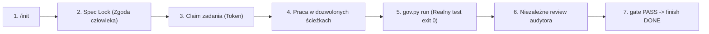

# Przewodnik Wdrożenia Frameworka na Nowym Komputerze

> **Cel:** Umożliwienie inżynierowi / osobie wdrażającej bezproblemowej, 1-komendowej instalacji **Antigravity Closed Loop Framework 3.0** w środowisku **Antigravity 2.0** na nowym stanowisku roboczym.

---

## 1. Wymagania Wstępne (Prerequisites)

Przed instalacją upewnij się, że na nowym komputerze zainstalowano:
1. **Python 3.11+**  
   * *Ważne na Windows:* Podczas instalatora Pythona zaznacz opcję: `[x] Add python.exe to PATH`.
   * Sprawdzenie w terminalu: `python --version` (musi zwrócić `Python 3.11.x` lub nowszy).
2. **Git**  
   * Sprawdzenie w terminalu: `git --version`.
3. **Antigravity 2.0** (Aplikacja desktopowa lub CLI).

---

## 2. Krok 1: Instalacja 1-Komendowa (Rejestracja Skilla `/init`)

Pobierz lub sklonuj folder `antigravity-v3-evidence-driven-framework`, otwórz w nim terminal (PowerShell lub CMD) i uruchom jednorazowo:

### Na systemie Windows (PowerShell):
```powershell
.\install_to_antigravity.ps1
```
*(Jeśli PowerShell zablokuje uruchomienie skryptu, wykonaj jednorazowo: `Set-ExecutionPolicy -Scope CurrentUser RemoteSigned`)*

### Na dowolnym systemie (Cross-platform Python):
```bash
python install_to_antigravity.py
```

### Co dzieje się automatycznie?
* [1/5] Weryfikacja wersji interpretera Python ($\ge 3.11$).
* [2/5] Weryfikacja obecności narzędzia Git.
* [3/5] **Rejestracja globalnego skilla `/init` wraz z wbudowanym master template** w katalogu konfiguracji Antigravity:  
  `~/.gemini/config/skills/init/` (wraz z silnikiem autodetekcji `detect_state.py` i autonomicznym bootstrapperem `bootstrap.py`).
* [4/5] Sprawdzenie poprawności silnika bramek `.governance/bin/gov.py doctor` i obsługi bazy SQLite.
* [5/5] Uruchomienie selftestów frameworka – **35/35 testów zaliczonych (PASS)**.

> [!IMPORTANT]
> Od tego momentu **NIE MUSISZ JUŻ UŻYWAĆ TERMINALA**!  
> Komenda **/init** jest aktywowana globalnie w Antigravity. Wystarczy otworzyć dowolny folder w aplikacji Antigravity 2.0 i wpisać `/init` bezpośrednio w oknie czatu!

---

## 3. Uruchamianie Bezpośrednio z Okna Czatu Antigravity 2.0

Osoba wdrażająca lub programista po jednorazowej instalacji wykonuje całą pracę wyłącznie przez czat:

1. **Otwórz w Antigravity 2.0 folder docelowy:**
   * Może to być pusty nowo utworzony folder (nowy projekt).
   * Może to być istniejący projekt z kodem (Node, Python, Rust, Go itp.).
2. **W oknie czatu wpisz:**
   ```text
   /init
   ```
3. **Agent wykonuje wszystko samoczynnie:**
   * Diagnozuje stan repozytorium (`S0_GREENFIELD` lub `S1_BROWNFIELD_UNMANAGED`).
   * Automatycznie nakłada silnik governance i reguły z wbudowanego globalnego szablonu.
   * W istniejącym projekcie wykrywa komendę testową (`npm test`, `pytest`) i zabezpiecza `AGENTS.md`.
   * Prezentuje raport gotowości i kolejny krok (np. zatwierdzenie Spec Lock).

---

## 4. Praca w Pętli Closed-Loop (Bramki Jakościowe)

Niezależnie od projektu, workflow gwarantuje brak halucynacji i samocertyfikacji:



1. **Spec Lock:** Człowiek zatwierdza hash wymagań:
   ```powershell
   python .governance/bin/gov.py approve-spec --actor human:owner --reference feature-v1
   ```
2. **Rezerwacja:** Agent pobiera token dzierżawy:
   ```powershell
   python .governance/bin/gov.py claim --task T001 --actor agent:builder --session <CONVERSATION_ID>
   ```
3. **Dowód testu:** Agent uruchamia testy w izolowanym procesie rejestrującym log SHA256:
   ```powershell
   python .governance/bin/gov.py run --task T001 --check <NAZWA_CHECKU>
   ```
4. **Niezależny odbiór:** Audytor QA (nie builder!) recenzuje snapshot:
   ```powershell
   python .governance/bin/gov.py review --task T001 --reviewer agent:qa-verifier --decision APPROVED --reference "raport-qa"
   ```
5. **Zamknięcie:**
   ```powershell
   python .governance/bin/gov.py finish --task T001 --token <TOKEN>
   ```

---

## 5. Rozwiązywanie Problemów (Troubleshooting)

| Problem | Przyczyna | Rozwiązanie |
|---|---|---|
| `ExecutionPolicy` blokuje `.ps1` | Domyślna polityka Windows PowerShell | Wykonaj: `Set-ExecutionPolicy -Scope CurrentUser RemoteSigned` |
| `python: command not found` | Python niezainstalowany lub brak w PATH | Zainstaluj Pythona 3.11+ i zaznacz opcję *Add python.exe to PATH* |
| `OUT_OF_SCOPE` podczas zapisu | Agent próbuje edytować pliki poza dozwolonym zakresem | Zezwól na rozszerzenie ścieżek w `tasks.json` lub zablokuj samowolkę agenta |
| `INDEPENDENT_REVIEW_REQUIRED` | Ten sam agent próbuje zatwierdzić własny kod | Przeprowadź audyt za pomocą innej roli (np. `agent:qa-verifier` lub człowiek) |
| Jak sprawdzić stan w dowolnym momencie? | Potrzeba podglądu bramek | Uruchom: `python .governance/bin/gov.py status` |
