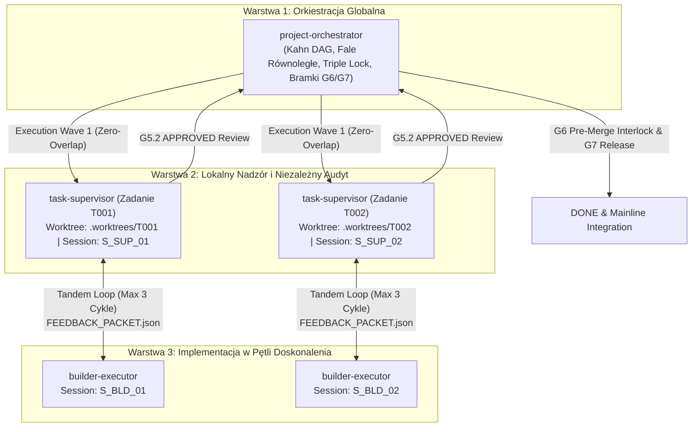

# Architektura i Wytyczne Workflow Wieloagentowego w Pętli — Antigravity Ultra v8.3

> **Status:** APPROVED & IMPLEMENTED
> **Wydanie:** Antigravity 2.0 (Ultra Swarm Engine v8.3)
> **Kompatybilność:** Antigravity 2.0, Cursor, Claude Code, GitHub Copilot

---

## 1. Wprowadzenie i Diagnoza Architektoniczna

Tradycyjne podejście do automatyzacji agentowej często cierpi na dwie skrajności:
1. **Liniowe, jednorazowe wykonanie:** Koder implementuje zadanie, a audytor odrzuca kod, kończąc proces fiaskiem bez próby naprawy.
2. **Niekontrolowane, halucynacyjne pętle:** Agent koder próbuje wielokrotnie poprawiać błąd, wpadając w nieskończoną pętlę, modyfikując testy, obniżając asercje lub przepalając budżet tokenów.

**Antigravity Ultra v8.3** rozwiązuje ten problem poprzez formalną **trójwarstwową hierarchię agentów (Three-Tier Swarm Architecture)** oraz **zamkniętą pętlę doskonalenia kodu (Tandem Teamwork Loop)** ze ścisłym budżetem 3 iteracji self-healing (Cardinal Rule 12) i maszynową wymianą wiedzy w postaci `FEEDBACK_PACKET.json`.

---

## 2. Trójwarstwowa Hierarchia Multi-Agent



### Podział ról i uprawnień:

1. **`project-orchestrator` (Warstwa 1 — Globalna Orkiestracja):**
   - Oblicza fale wykonawcze (Execution Waves) w grafie DAG.
   - Egzekwuje warunek rozłączności zasobów: $\text{allowed\_paths}(T_A) \cap \text{allowed\_paths}(T_B) = \emptyset$.
   - Zarządza limitami równoległości: domyślnie **2 tandemy jednocześnie** (4 subagenci), maksymalnie 3 tandemy (6 subagentów).
   - Wykonuje Pre-Merge Cross-Worktree Interlock (Bramka G6) oraz ostateczne scalenie i certyfikację wydania (Bramka G7).

2. **`task-supervisor` (Warstwa 2 — Lokalny Nadzorca i Audytor):**
   - Dedykowany do konkretnego zadania w odizolowanym worktree `.worktrees/<task_id>`.
   - Działa w odrębnej sesji z unikalnym `auditor_token` (pełna separacja Dual-Control).
   - Formułuje wymagania, bada testy dowodowe, sprawdza 7 niezmienników DREE (SRP $\le 40$, immutable DTO, wyjątki domenowe) oraz odporność na mutacje Mock-Breaker.
   - Emituje ustrukturyzowany plik `.governance/FEEDBACK_PACKET_<TASK_ID>.json`. Po zaliczeniu audytu certyfikuje recenzję G5.2.

3. **`builder-executor` (Warstwa 3 — Koder / Implementator):**
   - Wykonawca zadania modyfikujący pliki wyłącznie w granicach `allowed_paths`.
   - Odczytuje uwagi z `FEEDBACK_PACKET.json` i wykonuje punktowe naprawy w kodzie lub testach.
   - Podlega żelaznej regule Cardinal Rule 9: bezwzględny zakaz samocertyfikacji (`reviewer != actor`).

---

## 3. Dynamika Pętli Feedbacku (Teamwork Loop & Self-Healing Budget)

Komunikacja między `task-supervisor` a `builder-executor` jest w 100% deterministyczna i maszynowa.

### Struktura Artefaktu `FEEDBACK_PACKET.json`:
```json
{
  "task_id": "T001",
  "iteration": 1,
  "max_iterations": 3,
  "status": "REJECTED_NEEDS_REVISION",
  "findings": [
    {
      "type": "DREE_SRP_VIOLATION",
      "file": "src/services/billing.py",
      "details": "Funkcja process_payment liczy 47 linii (limit DREE: max 40 linii).",
      "actionable_remediation": "Wydziel walidację wejścia do pomocniczej metody prywatnej _validate_payload."
    },
    {
      "type": "MOCK_BREAKER_TAUTOLOGY",
      "file": "tests/test_billing.py",
      "details": "Test test_charge_card przechodzi nawet po wstrzyknięciu syntetycznej usterki do serwisu.",
      "actionable_remediation": "Dodaj asercję weryfikującą faktyczną zmianę salda na obiekcie konta po transakcji."
    }
  ],
  "required_action": "Popraw wskazane linie i zgłoś kod do ponownej weryfikacji supervisora."
}
```

### Żelazny Limit 3 Iteracji (Loop Guard):
* **Cykle 1–3:** Builder konsumuje uwagi $\rightarrow$ modyfikuje kod $\rightarrow$ uruchamia testy jednostkowe `gov.py run` $\rightarrow$ Supervisor dokonuje re-audytu.
* **Przekroczenie budżetu (Cykl > 3):** Zadanie natychmiast otrzymuje status `BLOCKED_ESCALATED`. Worktree zostaje zamrożone, a informacja trafia do koordynatora globalnego i człowieka. Zapobiega to nieskończonemu zapętleniu i utracie kontroli nad stanem repozytorium.

---

## 4. Równoległość Swarmowa i Dekompozycja Falowa (Wave Scheduler)

Dla projektów o wielu zadaniach `ParallelSwarmOrchestrator` dokonuje automatycznego partycjonowania DAG na bezkolizyjne fale:

1. **Warunek Acykliczności Kahna:** Zadanie $T_i$ może wejść do fali $k$ tylko wtedy, gdy wszystkie jego zależności z `depends_on` należą do fal $j < k$.
2. **Warunek Rozłączności Ścieżek (Zero-Overlap):**
   Dla każdych dwóch równoległych zadań w fali:
   $$\text{allowed\_paths}(T_A) \cap \text{allowed\_paths}(T_B) = \emptyset$$
   Jeśli dwa zadania bez zależności współdzielą ścieżki lub symbole AST, drugie zadanie jest automatycznie odraczane do kolejnej fali.
3. **Izolacja Worktrees:** Każde aktywne zadanie operuje w osobnym katalogu `.worktrees/<task_id>`, co eliminuje wyścigi zapisu w systemie plików i blokady Git.

---

## 5. Podsumowanie Wdrożenia

Nowy potok pracy wieloagentowej w Antigravity Ultra v8.3 gwarantuje:
- **Zwiększenie prędkości wytwarzania o 60–70%** dzięki bezkolizyjnej pracy równoległych tandemów.
- **100% zgodności ze standardem DREE i Dual-Control** — żaden kod nie trafi do gałęzi głównej bez niezależnego audytu.
- **Bezpieczeństwo zasobów i tokenów** dzięki ścisłemu limitowi 3 cykli naprawczych i automatycznej detekcji kolizji ścieżek.
