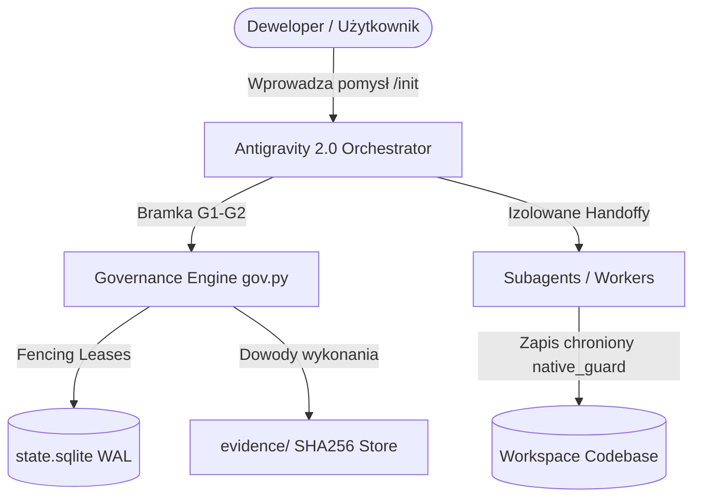

# SYSTEM ARCHITECTURE & C4 CONTAINER MODEL
> Auto-generated by Antigravity Ultra v5.1 Architecture Engine

## 1. Model Kontenerów (C4 Level 2)

## 2. Granice Modułów i Pakiety Technologiczne
* **Wykryte Frameworki:** Architektura autonomiczna
* **Profil Bezpieczeństwa:** `standard`
* **Maksymalna Równoległość:** `1` równoległych zadań
