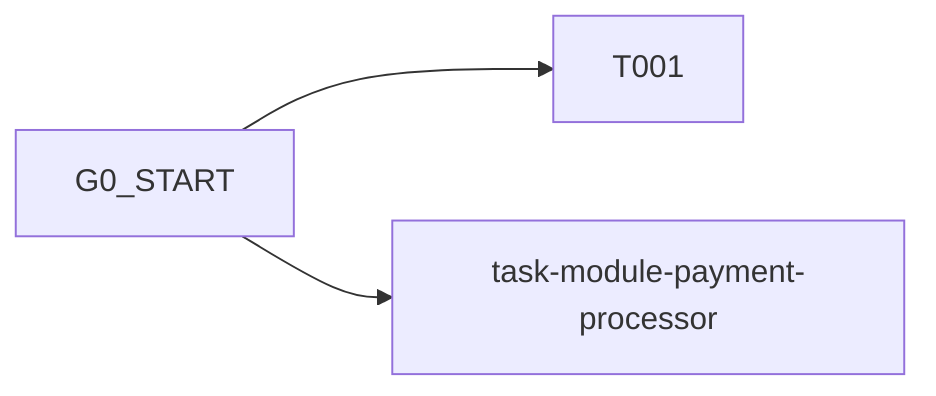

# TASK DEPENDENCY DAG & BLAST RADIUS MATRIX
> Auto-generated by Antigravity Ultra v5.1 Impact Engine

## 1. Acykliczny Graf Zadań (DAG)

## 2. Macierz Promienia Rażenia (Blast Radius)
| Zadanie | Ścieżki Zapisu | Ryzyko |
|---|---|---|
| `T001` | `tests` | `low` |
| `task-module-payment-processor` | `src/billing/payment_processor.py, tests/test_payment_processor.py` | `low` |
