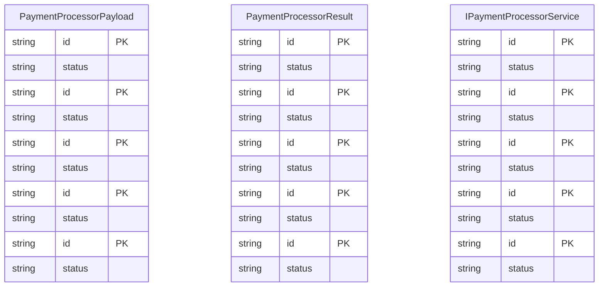

# RECONSTRUCTED SPECIFICATION & TOPOLOGY (BROWNFIELD S1)
> Auto-generated by Antigravity Ultra v5.1 (Omni-Agentic OS & DREE Engine) Discovery Engine at 2026-11-03T22:07:25.111555

## 1. Wykryty Stos Technologiczny
* **Frameworki:** Brak dedykowanego frameworka / Skrypty autonomiczne
* **Języki w projekcie:** Python (23 plików), TypeScript (2 plików)
* **Liczba zbadanych plikĂłw:** 155

## 2. Ocena Kruchości (Fragility Scorecard)
* **Wskaźnik Bezpieczeństwa (Score):** **50 / 100** (MODERATE)
* **Zarejestrowane Trasy API / Punkty Wejścia:** 1
* **Trasy bez pokrycia testami:** 1
* **Wykryte Testy Jednostkowe/Integracyjne:** 97

## 3. Schemat Modeli Danych (ERD)

## 4. Wykryte Trasy API i Punkty Końcowe
| Metoda | Ścieżka / Punkt Końcowy | Plik Źródłowy |
|---|---|---|
| `ROUTE` | `.agents/skills/init/scripts/detect_state.py` | `.agents/skills/init/template/.agents/skills/init/SKILL.md` |

## 5. Rekomendacje Modernizacji (Zero-Regression Roadmap)
1. **Golden Master Harness:** Przed edycjÄ… jakiejkolwiek logiki biznesowej, zarejestruj testy charakterystyczne za pomocÄ… `gov.py golden-record`.
2. **Contract Scaffolding:** Zamroź schematy wejścia/wyjścia w `contracts/` przed delegowaniem zadań subagentom.
3. **Izolacja Handoff:** Każde zadanie refaktoringu musi być ograniczone do ścisłego pliku handoffu (`gov.py package-handoff`).
